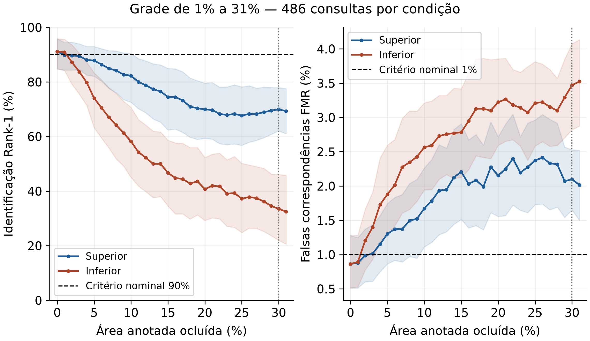

# Reconhecimento por íris e influência da área preservada

**Atualizado em 09/11/2026.** Os ensaios da grade inteira de 1% a 31% terminaram e foram auditados. O artigo foi consolidado no modelo UniSatc com 30 páginas de conteúdo e 4 de referências. O estudo permanece exploratório; não estabelece mínimo anatômico universal nem valida identificação clínica ou pelo celular.

## Atualização de novembro

- [Resultado final da grade de 1% a 31%](pfc1-segmentacao-mmu/RESULTADO_GRADE_DENSA_2026-11-08.md), [tabela completa](pfc1-segmentacao-mmu/outputs/grade_densa_analise_2026-11-08/tabela_completa.csv) e [auditoria](pfc1-segmentacao-mmu/outputs/grade_densa_analise_2026-11-08/AUDITORIA_FINAL.json): 63 condições da referência e 63 do candidato, sem substituição do modelo.
- [Relatórios da semana de 02 a 08/11](Relatórios-de-Avanço/SEMANA_2026-11-02.md) e [fechamento em 09/11](Relatórios-de-Avanço/SEMANA_2026-11-09.md): dias de atividade, resultados e limitações, com complemento da correção do cadastro em 05/11.
- [Artigo em texto](pfc1-segmentacao-mmu/artigo/ARTIGO_AREA_IRIS_EM_PRODUCAO.md) e [verificação final da entrega](pfc1-segmentacao-mmu/artigo/verificacao_2026-11-08/VERIFICACAO_FINAL.json): 31 referências, 12 tabelas e 5 figuras. O DOCX com fotografias e os painéis clínicos permanecem locais.
- [Reconhecedor para S23 e apresentação por USB-C](reconhecedor-iris/README.md): aplicativo local com cadastro separado e processamento no PC. O código reutiliza os modelos da pesquisa; pesos e dados pessoais não acompanham o Git.
- [Rodada SAM3.1 residual](pfc1-segmentacao-mmu/SAM3_RESIDUAL_2026-11-05.md): treino concluído, época 8 selecionada; os critérios de prontidão não foram atingidos e nenhum novo mínimo foi atribuído.
- [Revisão bibliográfica com 26 referências](pfc1-segmentacao-mmu/artigo/revisao_bibliografica_2026-11-05/RELATORIO_PESQUISA.md) e [delimitação do encerramento experimental](pfc1-segmentacao-mmu/artigo/revisao_bibliografica_2026-11-05/ENCERRAMENTO_EXPERIMENTAL.md).

Os números atuais e os históricos permanecem vinculados ao protocolo e ao ambiente de cada rodada. Não são acurácia do aplicativo de celular nem confirmação de um percentual universal de área anatômica.

Trabalho de conclusão de curso em Engenharia de Computação — UniSatc. Acadêmico: Lucas Cardoso Rodrigues. Orientador: Rodrigo Ramos Silva.

## Objetivo e estado atual

Investigar quanto da região visível da íris pode ser perdido mantendo identificação e controle de falsas correspondências. O experimento principal usa UBIPr em luz visível, segmentação automática, uma foto por consulta, lado do olho informado e cadastro com várias fotos da sessão 1. Cada consulta da sessão 2 compara 16 olhos do mesmo lado.

| Controle recalculado da grade de 08/11 | Resultado |
|---|---:|
| Rank-1: identificação do primeiro candidato | 443/486 — **91,15%** |
| TAR: aceitação genuína | 449/486 — **92,39%** |
| FMR: falsa correspondência entre olhos diferentes | 63/7.290 — **0,864%** |
| Identificação correta e aceitação simultâneas | 435/486 — **89,51%** |

A grade contém o controle e **cada inteiro de 1% a 31%**, nas posições superior e inferior. Treze condições foram reutilizadas após auditoria; cinquenta foram acrescentadas. Todas mantêm as mesmas 486 consultas, 7.290 pares impostores e falhas no denominador; seis referências têm área indefinida, com análise secundária no mesmo grupo fixo de 480 casos.

| Perda do suporte anotado | Rank-1 superior | Rank-1 inferior |
|---|---:|---:|
| 1% | 89,92% | 90,95% |
| 10% | 82,30% | 58,23% |
| 30% | 69,96% | 33,54% |
| 31% | 69,34% | 32,51% |



A posição da perda alterou o resultado, e a comparação entre 30% e 31% não demonstrou ruptura universal em 70%. As áreas são frações do suporte visível originalmente anotado; não medem o anel anatômico normativo ou a extensão de doença. Os intervalos por pessoa são descritivos, condicionados à galeria fixa, sem garantia populacional ou confirmação independente: validação e teste foram reutilizados no desenvolvimento.

O candidato com mistura fixa de 50% do novo escore polar elevou o evento correto e aceito limpo para **438/486 — 90,12%**, com **60/7.290 — 0,823% de FMR**. Entretanto, a FMR aumentou em 31 condições e a regra completa foi reprovada. A média conjunta nas 63 condições passou de 61,46% para 61,58%; a referência foi mantida. Os novos recortes subpixel suavizam a apresentação sem alterar RGB ou máscara binária e não demonstram, por si, ganho clínico.

O [teste histórico de outubro](pfc1-segmentacao-mmu/RESULTADOS_CONGELADOS_E_OCLUSAO_2026-10-21.md) registrou 444/486 de Rank-1, 449/486 de TAR e 64/7.290 de FMR. Suas contagens não foram substituídas. As comparações pareadas atuais usam o controle recalculado da própria rodada, com ambiente e proveniência registrados.

## O que vem no GitHub

O repositório contém código, documentação, resultados agregados, auditorias e o texto do artigo. **Clonar não baixa datasets nem entrega todos os pesos treinados.** Imagens brutas em `data/`, caches, checkpoints `.pt`, escores `.npz`, bancos do aplicativo e pacotes locais `.b64` são excluídos pelo `.gitignore`. As fotografias, os novos painéis clínicos, o DOCX que os incorpora e registros derivados por imagem permanecem locais. Gráficos científicos sem fotografias acompanham os resultados; imagens já rastreadas no histórico não são removidas por esta atualização.

Alguns documentos de proveniência apontam para esses recursos locais e seus hashes. Isso permite conferir a cópia original, mas não significa que todos os alvos de links locais acompanhem o clone. Os PNGs/PDF usados para conferir a paginação são intermediários de revisão, não a entrega pública do artigo.

As métricas publicadas não tornam o clone uma reprodução completa. Para repetir exatamente a fusão congelada, são necessários os checkpoints originais e seus hashes, dados, manifestos e modelos externos registrados no protocolo. Os pacotes em `backups/` só podem ser restaurados se suas partes locais também estiverem disponíveis; os inventários sozinhos não contêm os pesos. Ainda não há distribuição pública completa desses artefatos. Retreinar gera outra execução e não garante as mesmas métricas.

## Baixar o código

Instale Git e Python 3.12 de 64 bits. O caminho documentado é Windows/PowerShell; Linux/macOS ainda não foram validados neste projeto. GPU NVIDIA é recomendada para treinos completos; alguns pilotos em mapas já extraídos usam CPU.

```powershell
git clone --branch pesquisa/area-iris-2026-10-20 https://github.com/SouLucasCardoso/PDI_Anomalias_Oculares.git
cd PDI_Anomalias_Oculares/pfc1-segmentacao-mmu
```

Os comandos seguintes partem dessa pasta. A branch acima reúne o desenvolvimento e os registros da pesquisa; não representa certificação de desempenho.

## Preparar o ambiente

O ambiente da grade final foi registrado com **Python 3.12.10, PyTorch 2.14.1+cu130, torchvision 0.29.1+cu130, NumPy 1.26.4 e RTX 3050 Laptop de 6 GB**; consulte o [snapshot de versões](pfc1-segmentacao-mmu/outputs/ambiente_grade_densa_2026-11-08.json). O [lock Windows anterior](pfc1-segmentacao-mmu/requirements-windows.lock.txt) usa CUDA 12.6 e permanece histórico. Não é um lock integral da grade nova. O preparo separado do SAM3.1 está em [preparar_ambiente_sam3_atual.ps1](pfc1-segmentacao-mmu/preparar_ambiente_sam3_atual.ps1) e [requirements-sam3-atual.txt](pfc1-segmentacao-mmu/requirements-sam3-atual.txt). Não é necessário usar caminhos pessoais do autor.

Para o núcleo de segmentação/reconhecimento, crie um ambiente em caminho curto, fora de pastas sincronizadas:

```powershell
py -3.12 -m venv "$env:USERPROFILE/pfc-tcc-venv"
$pfcPython = Join-Path $env:USERPROFILE 'pfc-tcc-venv/Scripts/python.exe'
& $pfcPython -m pip install --upgrade pip

# Escolha UMA instalação de PyTorch:
# NVIDIA, CUDA 12.6 — roteiro do núcleo histórico, distinto da grade final:
& $pfcPython -m pip install torch torchvision --index-url https://download.pytorch.org/whl/cu126
# Alternativa CPU: substitua a linha anterior por:
# & $pfcPython -m pip install torch torchvision --index-url https://download.pytorch.org/whl/cpu

& $pfcPython -m pip install -r requirements.txt opencv-python-headless scipy scikit-learn timm gdown threadpoolctl
& $pfcPython -m pip check
New-Item -ItemType Directory -Force data | Out-Null
Set-Content -Encoding utf8 data/python-path.txt $pfcPython
```

Esse roteiro instala o núcleo histórico e não todos os modelos opcionais. Para tentar reconstruir aquele ambiente Windows, use um ambiente separado com `pip install -r requirements-windows.lock.txt --extra-index-url https://download.pytorch.org/whl/cu126`. O lock inclui SAM 3, Triton para Windows e fontes Git; sua compatibilidade deve ser conferida na máquina de destino. Não foi feita instalação limpa em outra máquina para validar este README. Para a grade final, o snapshot, o protocolo e as revisões registradas têm precedência sobre esse roteiro histórico; não atualize uma rodada ativa no meio da comparação.

O script legado `instalar.ps1` exige `../.runtime/python312/python.exe`, que não acompanha o clone. Use o procedimento acima em um computador novo; não execute aquele instalador esperando que ele baixe o Python.

O lançador lê `data/python-path.txt`, configura caches e executa os scripts:

```powershell
.\executar.ps1 -Script '-c' -Argumentos @('import torch; print(torch.__version__); print("CUDA:", torch.cuda.is_available())')
```

Se o Windows bloquear a execução do `.ps1`, é possível chamar `$pfcPython` diretamente, a partir desta pasta. Para bloqueios de gravação, consulte o Histórico de proteção e prefira uma pasta de saída temporária indicada pelo script; não é necessário desativar o Defender ou criar exclusões amplas. `diagnosticar_ambiente.py` verifica também SAM 3/OpenIRIS e seus pesos: não é um teste mínimo do núcleo.

## Baixar os dados principais

```powershell
.\executar.ps1 preparar_dados.py
# Nas próximas execuções, auditar sem baixar novamente:
.\executar.ps1 preparar_dados.py --no-download
```

Esse comando prepara **MMU e UBIPr**, sem iniciar treinamento. Os downloads ficam em `data/archives/`; os dados extraídos, em `data/`. A auditoria fica em `data/auditoria_instalacao.json`. Se um servidor mudar ou exigir autenticação, consulte a fonte indicada no script e não substitua o arquivo por outra versão sem registrar a mudança.

| Base | Cópia local auditada | Fonte e papel |
|---|---|---|
| UBIPr Single Eyes Segmented | 11.018 pares, 261 pessoas | [Fonte oficial](https://iris.di.ubi.pt/ubipr.html). Base principal de segmentação e identidade; CC BY-NC-SA 4.0. |
| MMU + máscaras | 450 pares, 45 pessoas | [Imagens usadas pelo script](https://www.kaggle.com/datasets/naureenmohammad/mmu-iris-dataset) e [máscaras](https://github.com/jkozlova/Masks-for-MMU-Iris-dataset). Etapa inicial de segmentação, sem rótulos clínicos. |

Respeite as licenças e cite cada fonte. Não envie os dados baixados ao GitHub.

## Bases clínicas opcionais

Não são necessárias para iniciar o experimento principal UBIPr. Estão disponíveis localmente no ambiente de pesquisa, mas não acompanham o clone. A aquisição clínica ainda não é automatizada por um único comando. Baixe dos autores, mantenha a estrutura do depósito e execute a auditoria correspondente:

| Base | Como obter e onde colocar | Auditoria |
|---|---|---|
| SLP-VLD v3 | [Depósito Figshare](https://doi.org/10.6084/m9.figshare.32576697.v3), arquivo original em `data/archives/slp-vld-v3.zip` | `auditar_slpvld.py` |
| CatScreen, somente amostra pública | [Página dos autores](https://www.iab-rubric.org/resources/healthcare-datasets/catscreen), link “Sample Dataset”; ZIP da amostra Data2025-main em `data/archives/catscreen-sample.zip` | `auditar_catscreen.py` |
| SLID | Git LFS: clonar `https://github.com/xumingyu-hub/SLID.git` em `data/slid/repository` e executar `git -C data/slid/repository lfs pull` | `auditar_slid.py` |
| Nuclear Cataract v2 | [Mendeley](https://data.mendeley.com/datasets/6wv33nbcvv/2), ZIP em `data/archives/nuclear-cataract-v2.zip`; obter também `NC_images_used_for_evaluation.xlsx` do [estudo de 2025](https://github.com/ignatowicz-alicja/AI-Powered-Mobile-App-for-Nuclear-Cataract-Detection) e colocar em `data/nuclear/` | `auditar_nuclear.py` |

Exemplo, depois de baixar o SLP-VLD:

```powershell
.\executar.ps1 auditar_slpvld.py
```

O auditor extrai e valida o ZIP, pareia as imagens aos diagnósticos e gera um manifesto com os caminhos desta máquina. Isso é necessário porque manifestos antigos podem conter caminhos absolutos do autor. O CatScreen completo exige acordo institucional; a amostra pública não é a base completa. Para SLID, verificar os termos dos dados antes de reutilizar ou redistribuir; acesso público não equivale a uma licença irrestrita.

Veja o [inventário atual de anomalias](pfc1-segmentacao-mmu/DATASETS_E_ANOMALIAS_2026-10-27.md). Catarata é alteração do cristalino, e não deve ser rotulada como lesão direta da íris. UBIPr/MMU não têm diagnósticos clínicos no protocolo atual.

Já foi iniciado um [estudo de recorte e reconhecimento em casos reais](pfc1-segmentacao-mmu/CASOS_OCULARES_REAIS_2026-10-27.md), com nove imagens de alterações explícitas da íris e quatro consultas elegíveis. O ensaio revelou falhas de segmentação/cadastro e não definiu percentual anatômico mínimo. Os casos UBIPr ilustrados não receberam diagnóstico clínico; ausência de rótulos não significa ausência de anomalias nas fotos.

O [relatório de 27/10](Relatórios-de-Avanço/RELATORIO_AVANCO_2026-10-27.md) compara o avanço desde 20/10 e inclui uma prancha SLP-VLD de rótulos Normal eye e alterações da íris. Resultados, pesos e pranchas recentes foram copiados diretamente para `outputs/` na pasta do OneDrive e conferidos por hash; isso não confirma o upload na nuvem.

## Modelos: download externo versus pesos do projeto

O núcleo usa uma U-Net treinada no projeto. SAM/DINO/OpenIRIS são recursos de comparação ou componentes de experimentos; baixar seus pesos não recria a U-Net ou toda a fusão principal.

```powershell
# Baixa/verifica os quatro recursos registrados no script:
.\executar.ps1 baixar_modelos.py
```

O script registra revisões e hashes em `data/modelos/status.json`. SAM 3.1/DINOv3 podem exigir aceite de licença e liberação na conta Hugging Face. Consulte [ACESSO_MODELOS_META.md](pfc1-segmentacao-mmu/ACESSO_MODELOS_META.md); autentique localmente e não publique tokens. As revisões usadas nos novos ensaios estão em [tecnologias_grade_densa_2026-11-08.json](pfc1-segmentacao-mmu/outputs/tecnologias_grade_densa_2026-11-08.json). O carregamento estrito do refino interativo foi verificado separadamente para backbone, prompts e decodificador; isso não corrige retroativamente a incompatibilidade parcial documentada em carregadores históricos nem garante compatibilidade de qualquer checkpoint.

Os caminhos e hashes dos pesos da fusão estão em [avaliar_candidato_congelado.py](pfc1-segmentacao-mmu/avaliar_candidato_congelado.py) e [CONGELADO.json](pfc1-segmentacao-mmu/outputs/candidato_congelado_2026-10-21/CONGELADO.json). Sem esses artefatos, limite-se a preparar dados, conferir código ou executar um novo treinamento com outro diretório de saída.

## Primeiro treinamento e consulta dos resultados

Com UBIPr preparado, iniciar um novo treinamento de segmentação:

```powershell
.\executar.ps1 treinar_segmentacao_ubipr.py --no-download --epochs 30 --batch-size 8 --base-channels 8 --seed 42 --output-dir outputs/cnn/minha_reproducao
```

O batch acima é conservador; não é promessa de reprodução numérica da execução anterior. Use um diretório novo e não sobrescreva resultados congelados. O treinamento da U-Net cobre segmentação, não o treinamento de todos os reconhecedores da fusão.

```powershell
# Marcadores de experimentos disponíveis nesta cópia:
.\executar.ps1 status_producao.py
# Teste direcionado do último descritor regional, no ambiente configurado:
.\executar.ps1 -Script '-m' -Argumentos @('unittest', 'test_descritor_regional_aprendido', '-v')
```

Os pilotos recentes dependem de caches preparados em etapas anteriores, alguns em `%TEMP%/pfc-tcc-resultados`. Ainda não existe um orquestrador público completo para reconstruir todas essas dependências em um clone novo. Consulte o protocolo de cada piloto; executar um arquivo isolado não garante que suas entradas estejam disponíveis.

## Organização e leitura recomendada

| Caminho | Conteúdo |
|---|---|
| `pfc1-segmentacao-mmu/` | Código, requisitos e documentação técnica |
| `pfc1-segmentacao-mmu/outputs/` | Métricas, protocolos e auditorias por experimento |
| `pfc1-segmentacao-mmu/artigo/` | Rascunhos e consolidação do artigo |
| `Relatórios-de-Avanço/` | Relatórios datados; consultar os mais recentes primeiro |
| `data/`, `backups/`, pesos e caches | Recursos locais; distribuição pública incompleta |

Comece pelo [fechamento da grade densa](pfc1-segmentacao-mmu/RESULTADO_GRADE_DENSA_2026-11-08.md) e pelos relatórios de [08/11](Relatórios-de-Avanço/RELATORIO_AVANCO_2026-11-08.md) e [09/11](Relatórios-de-Avanço/RELATORIO_AVANCO_2026-11-09.md). O [relatório de 27/10](Relatórios-de-Avanço/RELATORIO_AVANCO_2026-10-27.md), os [resultados congelados de outubro](pfc1-segmentacao-mmu/RESULTADOS_CONGELADOS_E_OCLUSAO_2026-10-21.md) e a [fronteira refinada](pfc1-segmentacao-mmu/FRONTEIRA_REFINADA_2026-10-23.md) preservam o histórico. A documentação em [INSTALACAO_LOCAL.md](pfc1-segmentacao-mmu/INSTALACAO_LOCAL.md) e no README interno acumula notas anteriores; referências a execuções em andamento ou percentuais antigos não substituem o estado consolidado aqui.

Este repositório é material de pesquisa. Ainda não constitui aplicativo de identificação ou sistema clínico validado. Cada dataset e modelo mantém seus próprios termos; este README não concede uma licença geral aos recursos de terceiros.
