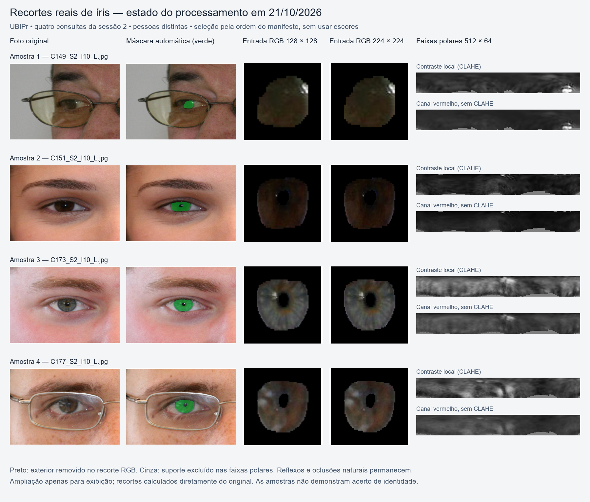

# Relatório de avanço — melhoria do reconhecimento e meta de desenvolvimento

**Data:** 21 de outubro de 2026  
**Projeto — foco atual:** Influência da área preservada da íris no reconhecimento de identidade sob oclusões controladas e alterações oculares  
**Acadêmico:** Lucas Cardoso Rodrigues  
**Orientador:** Rodrigo Ramos Silva  
**Entrega prevista do artigo:** 9 de novembro de 2026

## 1. Objetivo e situação da etapa

Foi atingido o critério de desenvolvimento de Rank-1 ≥90% e TAR ≥90%, com FMR ≤1%. O candidato foi congelado após reconstrução exata dos escores; ainda não há confirmação independente nem percentual mínimo de área.

## 2. Base e condições do experimento

UBIPr principal, uma foto original por consulta, lado do olho informado corretamente na captura, cadastro com múltiplas fotos da sessão 1 e consulta na sessão 2. São 482 consultas de 16 pessoas e 32 olhos físicos; cada consulta compara 16 olhos do mesmo lado. As quatro falhas de extração permanecem no denominador. O cenário anterior de 32 candidatos foi preservado.

## 3. Resultados sem oclusão artificial adicional

| Estratégia | Rank-1 | TAR | FMR |
|---|---:|---:|---:|
| Fusão5 com lado informado |87,34%|86,72%|0,98%|
| Fusão6, incluindo ResNet50 nativo224 |87,55%|86,93%|0,98%|
| Fusão7, incluindo Transformer polar |88,80%|88,80%|0,98%|
| Fusão8 com ArcIris e contraste local |89,42%|90,66%|0,98%|
| Fusão8 com ArcIris e canal vermelho |89,63%|90,04%|0,98%|
| **Candidato congelado: duas entradas ArcIris da mesma foto** |**90,04%**|**90,66%**|**0,98%**|

O candidato tem 434 identificações corretas e 437 aceitações genuínas em 482 consultas. São 71 aceitações impostoras em 7.230 comparações admissíveis (482×15). O limiar congelado é 0,8581747485460748. Rank-1 e TAR são medidas separadas: 426 consultas foram simultaneamente identificadas corretamente e aceitas (88,38%). Portanto, não foi atingido 90% no critério conjunto, caso esse seja exigido futuramente.

## 4. Trabalho realizado e modelos avaliados

Foram treinados ResNet50 com amostragem entre sessões, ConvNeXt com contraste, ResNet50 com recortes224 diretamente dos originais e Transformer polar derivado das seis primeiras camadas DINOv3. O modelo nativo224 selecionou época11 de 21; o Transformer selecionou época16 de 24 e seu checkpoint recarregado reproduziu exatamente os escores salvos. Foram preservados controles de classificadores de cadastro, adaptação usando somente sessão 1, qualidade de cadastro, protótipos por escala, alinhamento angular, variações de iluminação e fusão de probabilidades. Esses controles não substituíram automaticamente o melhor candidato. Uma execução de adaptação interrompida por tipo de rótulo foi corrigida e repetida em outra pasta; a interrupção técnica não foi tratada como resultado científico.

ArcIris foi avaliado com pesos públicos e código fixado do CVRL. Usamos nossa geometria automática da íris, não o pipeline IREX integral. A população do pré-treinamento não está documentada nos arquivos publicados; sobreposição de identidades não pode ser excluída. O resultado com esse componente é exploratório. As entradas vermelho e contraste são processamentos determinísticos da mesma foto, sem gerar textura ou acrescentar fotos de consulta.

A fusão congelada mantém sete componentes com peso 1/8 cada e ArcIris com peso 1/8, dividindo este último igualmente entre suas duas entradas. Os parâmetros de padronização e o limiar foram salvos. Nenhum peso foi escolhido por busca numérica. A validação, contudo, foi reutilizada para muitas estratégias: há viés de seleção e os percentuais não são confirmação independente.

## 5. Verificação, limitações e percentual mínimo de área

Os52 testes automatizados passaram. A reconstrução dos escores do candidato foi exata e conferiu todos os482 rótulos, falhas, acertos e aceitações; modelos e resultados foram preservados com conferência SHA-256.

O percentual mínimo de íris continua **não determinado**, com e sem oclusão. O resultado atual usa a íris disponível na foto original, sem nova oclusão artificial; isso não significa100% da anatomia visível. O próximo passo é implementar a avaliação completa com estes pesos, transformações, parâmetros e limiar congelados, registrar a exposição anterior do conjunto de teste e então avaliar as curvas de oclusão sem recalibrar o limiar em cada fração.

## 6. Estado atual dos recortes

A prancha apresenta quatro fotos reais da sessão 2 de validação, de pessoas distintas, escolhidas pela ordem do manifesto entre as entradas válidas, sem consultar acertos ou escores de reconhecimento. Cada linha mostra a foto original, a máscara inferida pela U-Net em verde, os recortes RGB de 128 × 128 e 224 × 224 pixels e as faixas polares de contraste local e canal vermelho. Os recortes são calculados diretamente dos originais e ampliados apenas para a exibição.

O exterior previsto como não pertencente à íris é removido dos recortes RGB; o suporte excluído da faixa polar recebe cinza. Reflexos, contornos imperfeitos e oclusões naturais permanecem: não foi gerada nem reconstruída textura ausente. A prancha documenta o processamento, sem demonstrar reconhecimento correto dessas amostras.

O JSON ao lado da imagem registra nomes dos arquivos, índices no manifesto, geometria e hashes dos originais e do checkpoint de segmentação.

## 7. Evidências e rastreabilidade

- [Congelamento e auditoria](../pfc1-segmentacao-mmu/outputs/candidato_congelado_2026-10-21/CONGELADO.json).
- [Resultado final de desenvolvimento](../pfc1-segmentacao-mmu/outputs/arciris_duas_vistas_2026-10-21/CONCLUIDO.json).
- [Treinamento Transformer](../pfc1-segmentacao-mmu/outputs/transformer_polar_2026-10-21/CONCLUIDO.json).
- Fonte do reconhecedor externo: https://github.com/CVRL/OpenSourceIrisRecognition (revisão 4a535e4a9a0728e4428c25f743f6d59098ae397f).
