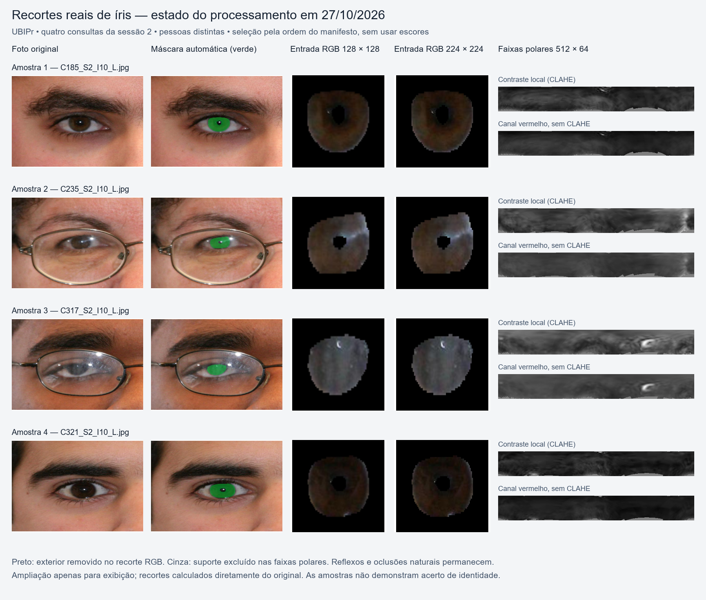
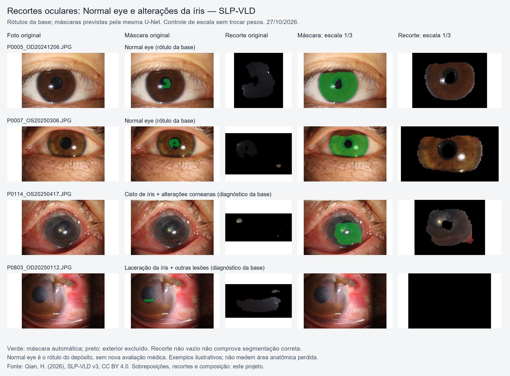

# Relatório de avanço — reconhecimento, área e casos oculares reais

**Data:** 27 de outubro de 2026  
**Acadêmico:** Lucas Cardoso Rodrigues  
**Orientador:** Rodrigo Ramos Silva  
**Período comparado:** terça-feira, 20/10, a terça-feira, 27/10/2026

**Entrega prevista do artigo:** 09/11/2026 — 13 dias após esta consolidação.

## 1. Situação atual

O projeto dispõe de um pipeline de segmentação automática, recortes RGB e normalização polar, reconhecimento por fusão de descritores e avaliação de perda simulada de área. A referência principal permanece em **444/486 identificações corretas (91,36%)**, sem oclusão artificial adicional. As tentativas posteriores não superaram conjuntamente os critérios estabelecidos e não substituíram essa referência.

A pergunta sobre área já tem uma resposta experimental limitada: na grade irregular avaliada, a menor área nominal aprovada foi **99,5% na oclusão superior e 99% na inferior**. Isso não estabelece um mínimo global válido para qualquer região, pessoa ou anomalia clínica. O resultado caracteriza a sensibilidade deste pipeline às intervenções estudadas.

## 2. Avanço em relação ao início da semana passada

Em 20/10, o extrator treinado com recortes de referência atingia **67,90% de Rank-1 (330/486)**. A referência atual atinge **91,36% (444/486)**: diferença descritiva de **23,46 pontos percentuais e 114 identificações corretas**. A comparação não isola um único fator: mudaram descritores, fusão, pré-processamento e o protocolo passou a usar o lado informado, com 16 candidatos do mesmo lado. A validação e o teste já foram examinados anteriormente; não é confirmação independente.

Desde o congelamento do resultado de 91,36%, houve avanço no diagnóstico, na delimitação da área aprovada e na rastreabilidade, mas **não houve ganho aprovado de reconhecimento**. Foram estudados localização da pupila, geometria elíptica, adaptação do descritor polar, penalização de impostores, normalização dos escores e diversidade das oclusões no treinamento. Os controles evitaram promover ganhos locais que não se sustentaram nos critérios completos.

O primeiro registro de terça passada, [Análise e preparação de 20/10](ANALISE_E_PREPARACAO_2026-10-20.md), descrevia a recuperação do ambiente e a falta dos checkpoints científicos anteriores. A [síntese biométrica do mesmo dia](AVANCO_BIOMETRIA_2026-10-20.md) e o [relatório de avanço de 20/10](RELATORIO_AVANCO_2026-10-20.md) documentaram os novos treinamentos e o extrator inicial. A comparação abaixo distingue esse ponto de partida do resultado consolidado de hoje:

| Etapa / medida | Terça-feira, 20/10 | Hoje, 27/10 |
|---|---|---|
| Ambiente e pesos | Recuperação do ambiente; os pesos antigos perdidos não estavam disponíveis. Novos treinos concluídos ao longo do dia. | Novos pesos e resultados preservados, com restauração e hashes conferidos. README principal criado. |
| Segmentação UBIPr | U-Net retreinada: Dice de íris 0,9342 no teste. | Mesma referência preservada; variantes não provaram ganho global. Identificadas falhas ao transferir a U-Net para fotos clínicas. |
| Rank-1 UBIPr sem perda artificial | 330/486 — 67,90%, extrator treinado e recorte de referência. | 444/486 — 91,36%, fusão com recorte automático e lado informado. Diferença descritiva: +114 acertos / +23,46 p.p. |
| TAR UBIPr | 268/486 — 55,14%. | 449/486 — 92,39%. |
| FMR UBIPr | 0,96%, no protocolo de então. | 64/7.290 — 0,8779%, com 16 candidatos do mesmo lado. Os conjuntos de pares não são idênticos aos de 20/10. |
| Área nominal mínima aprovada | Nenhuma fronteira global aprovada: o original já ficava abaixo de 90%. | Fronteiras pontuais da grade irregular: 99,5% superior / 99% inferior. Não há mínimo anatômico universal. |
| Avaliação clínica | HDBIF: 319 consultas, Rank-1 de 15,99%, TAR de 50,78%, FMR de 2,45%. | Além do estudo anterior, nove imagens com alteração explícita da íris foram examinadas; o sistema principal foi aplicado a quatro consultas de dois olhos, com controle de escala. Amostra/protocolo diferentes, sem comparação numérica direta com HDBIF. |
| Evidência visual | Prancha de recortes UBIPr e intervenções sintéticas. | Pranchas clínicas, exemplos UBIPr e comparação da mesma base entre rótulos Normal eye e alterações da íris, com falhas preservadas. |

O avanço da semana reúne reconstrução experimental, melhora descritiva do sistema e diagnóstico das limitações. A mudança de protocolo e a reutilização dos dados impedem atribuir toda a diferença a uma única técnica ou tratá-la como confirmação independente.

## 3. Resultados da referência congelada

Todas as condições abaixo mantêm 486 consultas, uma foto por consulta, lado informado, cadastro fixo da sessão 1, consulta na sessão 2 e o mesmo limiar. Rank-1 é identificação do primeiro candidato; TAR é aceitação genuína; FMR é falsa correspondência entre olhos diferentes. O critério adotado exige separadamente Rank-1 e TAR de pelo menos 90%, com FMR de até 1%.

| Condição | Área nominal preservada | Rank-1 | TAR | FMR | Critérios |
|---|---:|---:|---:|---:|---|
| Original, sem perda artificial | 100% | 91,36% | 92,39% | 0,8779% | Aprovados |
| Perda superior de 0,5% | 99,5% | 91,15% | 92,39% | 0,8916% | Aprovados |
| Perda superior de 1% | 99% | 89,92% | 92,39% | 0,88% | Reprovados |
| Perda inferior de 1% | 99% | 90,95% | 91,36% | 0,93% | Aprovados |
| Perda inferior de 1,5% | 98,5% | 89,09% | 88,89% | 1,0151% | Reprovados |
| Perda superior de 10% | 90% | 82,30% | 84,98% | 1,69% | Reprovados |
| Perda inferior de 10% | 90% | 58,23% | 60,29% | 2,61% | Reprovados |

Os números percentuais arredondados não substituem as contagens e escores preservados. Não foi avaliada perda inferior de 0,5%; portanto, 99,5% não é um nível aprovado em ambas as orientações. Entre os níveis coincidentes avaliados, somente a condição original passou nas duas. As seis consultas com referência vazia permaneceram inalteradas e no denominador; duas consultas do original tiveram falha de extração. A área nominal se refere à região visível anotada, não à anatomia inteira.

Identificar corretamente e aceitar são eventos distintos: na condição original, **436/486 (89,71%)** satisfizeram ambos simultaneamente. A aprovação pelos critérios separados não significa aprovação de um critério conjunto de 90%.

## 4. O que os últimos testes acrescentaram

- **Segmentação e geometria:** foi demonstrado que maior sobreposição da máscara com a anotação não garante maior reconhecimento. O diagnóstico com geometria da foto limpa recuperou desempenho sob oclusão, mas usa informação indisponível na captura de uma única foto ocluída e não é solução operacional.
- **Calibração:** um limiar global estimado nas perturbações internas controlou a FMR no monitor, mas, na validação limpa de 482 consultas, apresentou Rank-1 de 90,46%, TAR de apenas 64,32% e FMR de 0,2075%. A rejeição de genuínos impediu aprovação.
- **Troca isolada do polar:** preservando os parâmetros originais da fusão, a validação limpa ficou em 89,83% de Rank-1, 90,25% de TAR e 1,0235% de FMR. O candidato foi rejeitado antes de abrir novas oclusões ou teste.
- **Diversidade de treinamento:** foram preparadas 3.222 intervenções de 1% a 20% sobre 1.611 consultas de ajuste e concluídas oito épocas. No monitor reutilizado de 480 consultas, as perdas superior/inferior de 10% resultaram em Rank-1 de 82,92%/65,63% e FMR de 1,4028%/1,2917%. Não houve melhoria conjunta sobre o controle. O tratamento das dez vistas sem extração útil foi corrigido e retestado em 27/10, conforme a seção 8, sem ganho conjunto aprovado.
- **Auditoria e recuperação:** resultados, decisões e checkpoints dos pilotos foram preservados com hashes e restauração conferida. A gravação local não comprova sincronização na nuvem.

O monitor de treino reutilizado não é comparável diretamente ao teste principal. Nenhum percentual interno próximo de 99% substitui os 91,36% da referência. Em 27/10, foram concluídos o reteste de oito épocas, o piloto regional aprendido e os estudos de casos clínicos descritos nas seções 8 a 10.

## 5. Novas amostras dos recortes

A primeira tentativa de gravação direta no OneDrive falhou. Após a nova liberação informada pelo usuário em 27/10, o PNG foi copiado para esta pasta e conferido por SHA-256: `44fa98c4670ac882c9699e1736ce0a8d15637dd1d570c50a277f9750b55f5b68`. A cópia recuperável `.png.b64` e o JSON permanecem preservados. Nenhuma configuração de segurança foi alterada pelo agente. O PNG foi inspecionado visualmente e seu link agora é relativo ao relatório, sem depender de TEMP.

A prancha mostra quatro outras pessoas da validação: foram ignoradas as primeiras quatro pessoas elegíveis usadas na prancha anterior e selecionadas as quatro seguintes pela ordem do manifesto, sem consultar escores de reconhecimento. Cada linha contém foto original, máscara automática em verde, entradas RGB de 128 e 224 pixels e texturas polares CLAHE e canal vermelho. O segmentador é o da referência preservada; as imagens não representam um segmentador novo nem demonstram identificação correta. O JSON acompanhante registra os arquivos de origem, a seleção e os hashes.

Fonte desta prancha UBIPr: Padole, C.; Proença, H. (2012), *Periocular Recognition: Analysis of Performance Degradation Factors*. [Dados dos autores](https://iris.di.ubi.pt/ubipr.html), CC BY-NC-SA 4.0. A composição, as sobreposições e os recortes são derivados produzidos neste projeto e mantêm os termos de atribuição, uso não comercial e compartilhamento pela mesma licença.

### Exemplos com e sem alteração clínica documentada

As duas primeiras linhas têm rótulo exato **Normal eye** no SLP-VLD; as duas seguintes têm diagnósticos que incluem **cisto de íris** e **laceração da íris**. Não foi atribuído diagnóstico pela aparência. Os controles Normal eye são os primeiros dois participantes distintos do desenvolvimento por nome de arquivo. Os dois casos alterados ilustram tanto recuperação quanto falha do controle de escala; não estimam prevalência nem formam um experimento clínico pareado. O reconhecimento dos dois controles normais não foi avaliado nesta prancha.

Cada linha mostra a foto original, máscara e recorte do sistema original e máscara e recorte do controle fixo de escala 1/3. A U-Net também apresenta recortes fragmentados nos exemplos Normal eye: a transferência de captura é um confundidor e as falhas não podem ser atribuídas exclusivamente à anomalia. O controle melhora visualmente alguns exemplos, mas falha no cadastro com laceração; não substituiu o sistema original. Máscara prevista não é referência de área anatômica.

Fonte: Qian, Hulei (2026), *SLP-VLD: An Anonymized Slit-Lamp Image Dataset with Expert Clinical Reports for Vision-Language Modeling of Anterior Segment Diseases*, v3. [Depósito dos autores](https://doi.org/10.6084/m9.figshare.32576697.v3), CC BY 4.0 segundo o registro oficial preservado. A composição, as máscaras sobrepostas e os recortes são adaptações deste projeto. O [JSON de rastreabilidade](COMPARACAO_RECORTES_NORMAL_ANOMALIA_2026-10-27.json) registra seleção, diagnósticos originais e hashes.

## 6. O que falta e prioridade até a entrega

O pipeline e os resultados necessários para um estudo de sensibilidade já existem. Falta obter evidência de robustez suficiente para sustentar uma redução expressiva da área necessária; as novas tentativas ainda não entregaram isso. A correção de vistas inválidas já foi testada e não resolveu a meta. Para a extensão clínica, falta uma segmentação de referência revisada que separe erro de extração de perda verdadeira de tecido. Devem ser preservadas a definição da FMR por pares e a separação entre calibração e avaliação.

É necessário fechar no artigo a interpretação da grade irregular, a incerteza, a exposição anterior dos conjuntos e a distinção entre oclusões artificiais e anomalias reais. Não há dados clínicos suficientes nesta evidência para quantificar diretamente o impacto de doenças. Não é possível atribuir uma porcentagem confiável de conclusão científica ao objetivo de um mínimo universal; o resultado atual é uma fronteira experimental condicionada ao protocolo.

Com 13 dias até a entrega, a prioridade é uma hipótese adicional limitada e bem controlada, acompanhada da consolidação do artigo, figuras e tabelas. O estudo não deve depender de uma promessa de atingir uma área menor antes de 09/11.

## 7. Evidências

- [Relatório de 20/10](RELATORIO_AVANCO_2026-10-20.md): reconstrução, segmentação e referência inicial de 67,90%.
- [Relatório de 21/10](RELATORIO_AVANCO_2026-10-21.md): congelamento e teste de 91,36%.
- [Relatório de 23/10](RELATORIO_AVANCO_2026-10-23.md): refinamento da fronteira para 99,5%/99%.
- [Rodada de refinamento](../pfc1-segmentacao-mmu/outputs/fronteira_meio_ponto_2026-10-23/CONCLUIDO.json): métricas dos dois pontos adicionais.
- [Relatório de 24/10](RELATORIO_AVANCO_2026-10-24.md): candidatos rejeitados e auditorias.
- [Diversidade de oclusão](../pfc1-segmentacao-mmu/DIVERSIDADE_OCLUSAO_2026-10-24.md): método, resultados e limitações do último piloto.

## 8. Continuação em 27/10: correção do treinamento

Após a consolidação acima e o envio ao GitHub, foi corrigida a contribuição de vistas sem extração útil nas três perdas de identidade. As 6.067 fotos continuam no ajuste; dez vistas inválidas (duas superiores e oito inferiores) têm contribuição zerada, sem aumentar o peso das demais. Cinco testes passaram, incluindo equivalência de valores e gradientes com a versão anterior quando todas as vistas são válidas.

Um novo ensaio registrado repetiu oito épocas com os mesmos mapas, sorteios, pessoas, inicialização, otimizador e critérios. A época 8 foi selecionada sem consultar o monitor durante o treino. No monitor reutilizado, o limpo manteve 479/480 de Rank-1/TAR (99,79%) e FMR de 0,6806%. Nas oclusões superior/inferior de 10%, o Rank-1 foi **397/480 (82,71%) e 314/480 (65,42%)**, o TAR foi **79,38%/57,92%** e a FMR foi **1,3333%/1,2639%**. Em relação ao piloto diverso anterior, houve uma identificação correta a menos em cada orientação e cinco/duas falsas correspondências a menos. A correção não trouxe superioridade conjunta e não atingiu a meta.

Nenhuma inferência nova na validação/teste foi executada; os resultados principais e a fronteira de área permanecem iguais. A seção anterior que descreve apenas consolidação e visualização se refere à etapa inicial do dia, antes desta continuação. [Detalhes do ensaio e testes](../pfc1-segmentacao-mmu/VISTAS_VALIDAS_2026-10-27.md).

A auditoria reproduziu exatamente os escores e as decisões, conferiu a seleção pela perda de ajuste e limpo interno e verificou as dez flags de vistas inválidas. O pacote de 42 arquivos foi restaurado com conferência de hashes, incluindo os dois checkpoints originais; nove cópias JSON/CSV foram preservadas para leitura. Não houve mudança nas configurações de segurança ou confirmação de sincronização na nuvem.

## 9. Mudança estrutural: descritores regionais aprendidos

Foi registrado e executado um piloto diferente dos ajustes globais: oito regressões regionais aprendem a prever descritores de identidade a partir de setores do mapa polar, usando somente as 151 pessoas de ajuste. A fusão primária, fixada previamente, combina 75% global e 25% regional, mantendo seis das oito concordâncias por par de fotos. O limiar foi calibrado apenas no grupo interno limpo. Foram mantidos controles global, regional isolado e fusão com todos os setores.

A fusão preservou 479/480 (99,79%) de Rank-1/TAR no monitor limpo e passou a porta que autorizava avaliar oclusões. Nas perdas superior/inferior de 10%, obteve **82,71%/61,88% de Rank-1**, **75,63%/51,46% de TAR** e **0,9167%/0,8472% de FMR**. O controle global tinha FMR de 1,3472%/1,2639%, mas TAR maior (76,88%/53,96%). Controlar impostores não bastou para a aprovação conjunta. O controle com todos os setores também reduziu a FMR e teve o mesmo Rank-1, impedindo atribuir o resultado exclusivamente ao descarte regional.

Quatro testes passaram e a auditoria reproduziu exatamente o ajuste, as entradas, os escores e as decisões. O candidato não foi promovido, nenhuma consulta de validação/teste recebeu nova inferência e as fronteiras de área não mudaram. Os resultados são do monitor de treino reutilizado e não substituem a referência principal. [Método, controles e números completos](../pfc1-segmentacao-mmu/DESTILACAO_REGIONAL_2026-10-27.md).

## 10. Casos clínicos reais e exemplos naturais UBIPr

Foram processadas 42 fotografias SLP-VLD com o sistema principal congelado, incluindo todas as nove imagens com diagnóstico explícito da íris e três acompanhamentos dos mesmos olhos. Seis dos oito olhos clínicos só têm uma captura e não permitem identificação genuína sem cadastro. Dois olhos forneceram quatro consultas, comparadas a 16 candidatos nominais do mesmo lado, com cadastro e limiar congelados.

O sistema original teve 0/4 identificações/aceitações genuínas e 1/60 falsas correspondências (1,67%). Uma consulta não tinha comparação genuína disponível por máscara vazia no cadastro. A inspeção revelou falhas de segmentação e extração de fragmentos, impedindo interpretar a máscara como medida de anatomia preservada.

Um controle posterior, registrado antes da segunda execução, manteve pesos e limiar e apresentou a foto clínica em escala fixa 1/3 à U-Net. Recuperou o cadastro P0114 e identificou/aceitou sua consulta (escore 0,87538), mas esvaziou o cadastro P0803 e indisponibilizou as outras três comparações genuínas. O total foi 1/4 acertos/aceitações e 2/60 falsas correspondências (3,33%). Não foi promovido; a hipótese de escala não resolveu o domínio clínico como um todo.

No UBIPr, reaproveitaram-se as decisões e medidas das 482 consultas de validação. Foram geradas ilustrações de seis pessoas escolhidas por suporte polar e ordem, sem diagnóstico atribuído à aparência. Um caso foi corretamente identificado e aceito com suporte polar de 47,36%, o que não equivale a 47,36% da anatomia preservada nem define um mínimo global. Não houve nova inferência de reconhecimento UBIPr ou inspeção das 11.018 imagens.

As auditorias reproduziram fusão, identidades, decisões, limiar e grupos; hashes das 42 fotos foram conferidos. Passaram três testes direcionados de seleção de candidatos e escala. Foram produzidas pranchas com originais, máscaras, recortes e faixas polares. A continuação clínica requer segmentação de referência revisada e validação dos vínculos/capturas, separando erro do algoritmo de perda real de tecido. [Resultados completos e localização das imagens](../pfc1-segmentacao-mmu/CASOS_OCULARES_REAIS_2026-10-27.md).

## 11. Preservação direta no OneDrive e atualização do repositório

Após o usuário permitir a gravação em tempo real, a cópia voltou a funcionar sem alteração de configurações pelo agente. Foram trazidos de TEMP os arquivos recuperados dos pilotos de vistas válidas, destilação regional e dois estudos de casos clínicos. Incluem checkpoints, modelo regional, escores, fontes registradas e as seis pranchas completas. A evidência de ajuste regional foi copiada separadamente; caches grandes de pré-processamento regeneráveis não foram duplicados.

O conjunto conferido contém **96 arquivos, 156.027.730 bytes**, nos diretórios `pfc1-segmentacao-mmu/outputs/` e `Relatórios-de-Avanço/`. A comparação normal/alterado e seu JSON foram gerados diretamente na pasta sincronizada. O [inventário de hashes](../pfc1-segmentacao-mmu/outputs/transferencia_onedrive_2026-10-27/ARQUIVOS_CONFERIDOS.json) permite conferir os arquivos locais. Cópias recuperáveis anteriores continuam preservadas; as pranchas já não dependem exclusivamente de TEMP. **O upload efetivo do cliente OneDrive não foi confirmado.**

O envio Git inclui códigos, documentação, métricas e as pranchas selecionadas deste relatório, com créditos e termos de cada base. Os datasets, checkpoints, arrays de escores e pacotes completos locais permanecem fora do Git. Os 12 testes direcionados das novas linhas (cinco de vistas válidas, quatro regionais, um de identidade/lado e dois de escala) foram executados, além das auditorias; não se declara execução recente de toda a suíte histórica.

