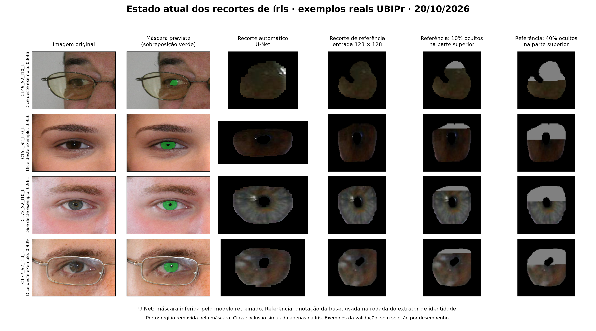

# Relatório de avanço — reunião de orientação

**Aluno:** Lucas Cardoso Rodrigues  
**Data:** 20 de outubro de 2026  
**Entrega prevista do artigo:** 9 de novembro de 2026

## Situação atual

O projeto foi retomado com novos treinamentos e experimentos reproduzíveis após a perda dos testes anteriores. O foco atual é investigar quanto da região visível da íris pode ser perdido sem comprometer a identificação, usando bases públicas e oclusões controladas. A classificação de doenças deixou de ser o objetivo principal.

**Os experimentos desta rodada terminaram. Já existem resultados, curvas, pesos preservados e texto do artigo em elaboração. Ainda não foi demonstrado um percentual mínimo global de íris suficiente para identificação.**

## Entregas e números

| Etapa | Execução concluída | Resultado |
|---|---|---|
| Segmentação da íris | U-Net, UBIPr, 30 épocas; melhor modelo selecionado na época 26 | Dice da íris no teste: **0,9342**; média das classes de primeiro plano: **0,8944** |
| Referência inicial de reconhecimento | DINOv3 com recorte de referência da íris; 486 consultas, 16 pessoas, 32 olhos | Rank-1 **13,37%**; TAR **7,00%**; FMR **1,47%** |
| Extrator treinado para identidade | ResNet18 com margem angular; 183 pessoas e 366 classes de olho no treinamento; parada na época 23, modelo selecionado na época 15 | Nas mesmas 486 consultas: Rank-1 **67,90%**; TAR **55,14%**; FMR **0,96%** |
| Reconhecimento em base clínica pública | HDBIF no SLP-VLD; teste de 319 consultas, 107 pessoas e galeria de 176 olhos; configuração congelada antes do teste | Rank-1 **15,99%**; TAR **50,78%**; FMR **2,45%** |
| Curvas de perda de área | Original e oclusões superiores/inferiores de 10% a 90% | **19 condições por rodada**, concluídas para DINOv3 e para o extrator treinado |
| Verificação e preservação | Testes de métricas, máscaras, limiares e regras de área; backup com integridade verificada | **18 testes aprovados**; código, pesos, protocolos e resultados preservados |

**Como ler:** Rank-1 é a proporção de consultas cujo primeiro candidato é o olho correto. TAR é a taxa de aceitação de comparações genuínas no limiar fixado pela validação. FMR é a taxa de falsas correspondências entre olhos distintos. Dice mede a sobreposição entre a máscara prevista e a referência. TAR e Rank-1 medem comportamentos diferentes e não devem ser confundidos.

## O que já podemos afirmar sobre perda de área

O critério registrado exige **Rank-1 e TAR de pelo menos 90%**, mantendo aprovação em todos os níveis maiores de área preservada. O modelo não atingiu esse critério nem na imagem original. Portanto, **o mínimo global permanece não determinado**, e não seria correto anunciar que “X% da íris basta”.

Como análise secundária exploratória, **234 de 486 consultas** foram simultaneamente identificadas corretamente e aceitas no limiar no original. Ao ocultar **10% da área anotada**, mantiveram esse sucesso:

- Oclusão superior: **117/234 = 50,00%**.
- Oclusão inferior: **115/234 = 49,15%**.

Esse resultado mostra sensibilidade à oclusão entre os casos que já funcionavam. O denominador é o subconjunto de 234 consultas, não todas as 486. As porcentagens se referem à região visível anotada, que pode já conter oclusões naturais; não à superfície anatômica total da íris.

## Limitações e decisões metodológicas

- O teste UBIPr já havia sido observado na rodada inicial. A avaliação do novo extrator está identificada como **exploratória**, sem alegação de novo teste independente. A diferença entre modelos também envolve arquitetura, resolução e treinamento.
- As oclusões são simuladas. Elas ajudam a estudar disponibilidade de textura, mas **não provam efeito causal de catarata ou de outra doença**.
- No SLP-VLD, houve dez falhas de imagem e três cadastros indisponíveis. Capturas oblíquas, reflexos e segmentações imprecisas limitam o reconhecimento. Os casos não foram removidos após observar os resultados.
- A Nuclear Cataract foi inspecionada, mas a execução foi **interrompida antes dos escores biométricos**: os primeiros exemplos apresentaram recortes fragmentados e iluminação inadequada para o pipeline adotado. Nenhum resultado de reconhecimento dessa base é apresentado.

## Estado do artigo e próximos passos

O texto ativo está em `pfc1-segmentacao-mmu/artigo/ARTIGO_AREA_IRIS_EM_PRODUCAO.md`, com resumo, fundamentação, métodos, resultados, discussão, conclusões e referências de trabalho. As figuras científicas já foram geradas. O texto ainda precisa de revisão científica, normalização bibliográfica e diagramação no modelo institucional; não é a versão final para submissão.

Na reunião, propõe-se alinhar três decisões:

1. Consolidar título e contribuição como **análise de robustez à perda de área**, relatando com transparência que o mínimo global não foi determinado.
2. Definir o peso da avaliação clínica no artigo: evidência complementar das limitações de aplicação, sem alegação causal.
3. Priorizar fechamento do texto, referências e formatação até 09/11. Uma nova rodada só deve ser assumida com hipótese específica e avaliação independente viável no prazo.

**Síntese para apresentação oral:** “Reconstruímos os experimentos e concluímos o retreinamento. A segmentação atingiu Dice de 0,9342. O extrator de identidade chegou a 67,90% de Rank-1 e 55,14% de TAR, com 0,96% de FMR. A curva mostra queda relevante quando ocultamos parte da região anotada, mas ainda não sustenta um mínimo universal. Temos resultados e figuras para o artigo; agora precisamos fechar a interpretação com a orientação e concluir a revisão e a formatação.”
