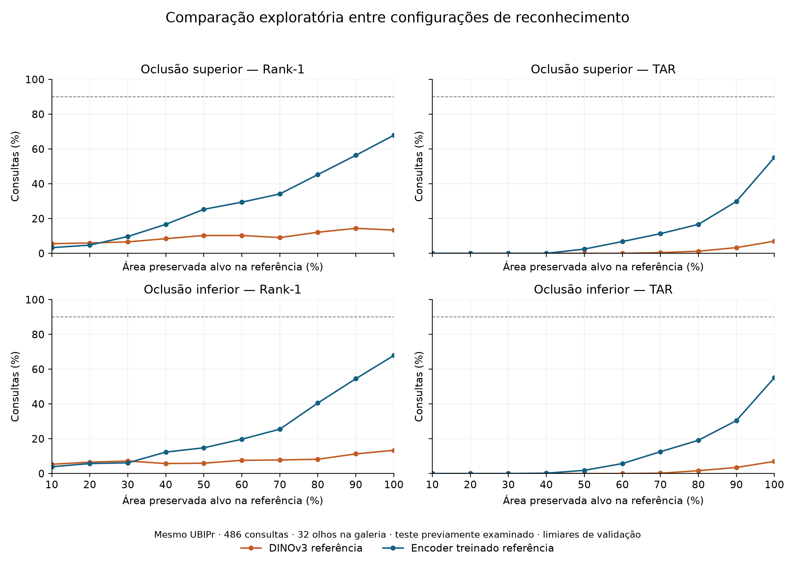
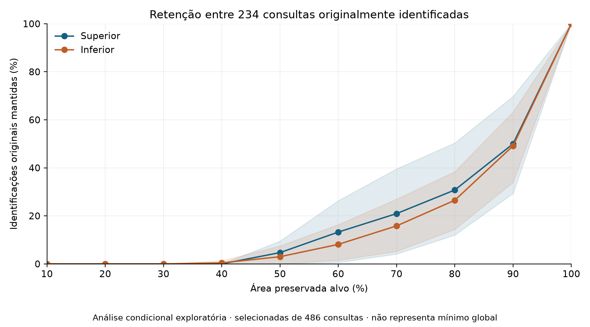

# INFLUÊNCIA DA ÁREA PRESERVADA DA ÍRIS NO RECONHECIMENTO DE IDENTIDADE SOB OCLUSÕES CONTROLADAS E ALTERAÇÕES OCULARES

Lucas Cardoso Rodrigues — Orientação: Rodrigo Ramos Silva

Rascunho atualizado em 20/10/2026. O título é provisório. Este é o texto ativo; o rascunho anterior sobre classificação permanece como histórico. As duas rodadas UBIPr e o teste clínico HDBIF terminaram. A tentativa Nuclear foi interrompida por inspeção de qualidade, antes de escores de reconhecimento. A diagramação no modelo institucional e a revisão bibliográfica final permanecem pendentes.

**Resumo:** Investigou-se a relação entre área preservada da íris e reconhecimento de identidade ocular em bases públicas, distinguindo perda controlada de pixels de alterações clínicas reais. No UBIPr, uma U-Net foi retreinada para segmentação e avaliaram-se a condição original e oclusões superiores e inferiores de 10% a 90%. O reconhecimento utilizou galeria fixa de 32 olhos e 486 consultas de 16 pessoas, com limiares calibrados na validação para taxa empírica de falsa correspondência de até 1%. Foram estudados DINOv3 e, em rodada exploratória, um extrator ResNet18 treinado para identidade ocular com margem angular. Como extensão, avaliou-se HDBIF em 319 consultas clínicas da SLP-VLD, mantendo configuração e limiar congelados. A U-Net obteve Dice de 0,9342 para a íris no teste. O extrator treinado apresentou Rank-1 de 67,90%, taxa de aceitação genuína de 55,14% e falsa correspondência de 0,96% no UBIPr. No teste clínico, HDBIF apresentou 15,99%, 50,78% e 2,45%, respectivamente. Nenhuma configuração atendeu ao critério global registrado de 90% de Rank-1 e aceitação genuína, impedindo determinar um mínimo operacional. A análise condicional mostrou perda de aproximadamente metade das identificações originais do extrator treinado após oclusão de 10%. Os resultados indicam dependência do reconhecedor, da região extraída e da aquisição, sem estabelecer um percentual universal ou efeito causal de doença.

**Palavras-chave:** Biometria da íris. Reconhecimento de identidade. Oclusão. Segmentação. Alterações oculares.

## 1 INTRODUÇÃO

A avaliação da área disponível da íris requer distinguir a quantidade de pixels preservados da capacidade de reconhecer o olho. A disponibilidade de uma região segmentada não demonstra, por si só, que sua textura permita separar identidades. O desempenho também depende da resolução, do enquadramento, da iluminação, da qualidade da segmentação e do reconhecedor utilizado. Por esse motivo, o percentual mínimo de área não será tratado como uma constante universal.

O estudo investiga a relação entre frações preservadas da íris e o reconhecimento de identidade ocular em imagens públicas. O experimento controlado altera somente a região anotada da íris e mantém uma galeria fixa. Como complemento, examina-se a viabilidade de avaliar imagens com condições oculares reais e capturas repetidas. Os dois componentes respondem a questões distintas: a manipulação controlada permite medir o efeito de uma perda de área definida; os registros clínicos permitem observar associações sob condições de aquisição e diagnósticos presentes na base.

O objetivo geral consiste em estimar, para os reconhecedores e condições experimentais avaliados, a relação entre área preservada e desempenho biométrico. Os objetivos específicos são reproduzir a segmentação com pesos novamente treinados; reconstruir a avaliação com identidade definida por pessoa e lateralidade; medir curvas de desempenho em níveis de oclusão predefinidos; e examinar os limites de transferência para imagens clínicas públicas com capturas repetidas. O UBIPr foi disponibilizado para análise periocular por Padole e Proença (2012); sua versão segmentada permite distinguir a referência da íris do contexto da imagem. [Fonte oficial da base e citação exigida](https://iris.di.ubi.pt/ubipr.html).

O trabalho não pressupõe que uma porcentagem de oclusão sintética corresponda à extensão de uma doença. Também não se pressupõe que o reconhecedor alcance desempenho suficiente na condição original. Se o critério operacional não for atendido sem oclusão, a conclusão será de mínimo não determinado para esse reconhecedor e amostra.

### 1.1 Representação e informação disponível

Daugman (2004) descreve a codificação da textura da íris e a comparação por distância de Hamming, com máscaras que removem artefatos da comparação. A região considerada válida em duas imagens interfere no conjunto de bits efetivamente comparados. Assim, a máscara participa da decisão biométrica; sua quantidade de pixels, isoladamente, não informa a capacidade de distinguir identidades. A normalização também busca reduzir variações associadas à geometria de aquisição. [Fonte primária](https://www.robots.ox.ac.uk/~az/lectures/est/iris.pdf).

No presente estudo, distingue-se área segmentada de área preservada. A primeira é a região rotulada ou prevista como íris. A segunda é a parcela dessa região mantida após uma intervenção controlada. A expressão “área útil” será evitada quando não houver evidência de que a região efetivamente contribui para reconhecimento: pixels podem permanecer visíveis e, ainda assim, não produzir características discriminativas no extrator escolhido.

Para uma máscara não vazia com N pixels e uma intervenção que substitui n desses pixels, a fração preservada é (N − n)/N. O valor depende da referência utilizada. No UBIPr, emprega-se a anotação disponível; na extensão Nuclear, utiliza-se uma previsão congelada. Uma fração calculada sobre a previsão deve ser descrita como área estimada. Se a máscara estiver vazia, a fração de área não é definida; a falha permanece na avaliação operacional, mas não recebe interpretação anatômica.

O nível 100% representa toda a região anotada ou prevista naquela imagem, que pode já conter apenas a parte visível da íris. Não equivale necessariamente a toda a superfície anatômica, inclusive a região escondida pelas pálpebras. As porcentagens deste estudo são relativas a essa referência de imagem.

### 1.2 Condições oculares e interpretação dos efeitos

Trokielewicz, Czajka e Maciejewicz (2015) avaliaram 2.996 imagens de 230 olhos, incluindo olhos com diferentes condições oculares. O estudo identificou sensibilidade do cadastro a obstruções e distorções e destacou a contribuição de erros de segmentação para a queda de confiabilidade. Essa evidência motiva registrar falhas desde o cadastro, em vez de avaliar apenas comparações que terminaram com sucesso. Ela não estabelece um percentual mínimo universal aplicável às bases deste trabalho. [Fonte primária](https://doi.org/10.1109/BTAS.2015.7358747).

Saleh e Menemencioğlu (2023) investigaram segmentação e reconhecimento com transferência de aprendizado em bases Warsaw BioBase e relataram limitações associadas a alterações oculares, com destaque para a segmentação. O artigo constitui antecedente temático relevante. Seus valores de acurácia não serão comparados diretamente aos deste trabalho sem compatibilizar dados, partições e definição da tarefa. [Registro institucional dos autores](https://doi.org/10.1016/j.jestch.2023.101552).

Os experimentos aqui propostos não substituem um estudo clínico longitudinal. Imagens com rótulos diagnósticos permitem descrever desempenho em uma população documentada; demonstrar o efeito causal de uma doença exigiria desenho que separasse mudanças clínicas de aquisição, tratamento, iluminação, pose e outros fatores. A oclusão controlada responde a uma pergunta mais restrita: como o reconhecedor se comporta quando uma fração conhecida da região definida pelo protocolo é substituída?

### 1.3 Identificação, verificação e critério operacional

Uma consulta genuína compara representações do mesmo olho; uma comparação impostora utiliza olhos diferentes. A TAR mede a proporção de consultas genuínas aceitas acima do limiar, e a FMR mede a proporção de comparações impostoras aceitas. No protocolo fechado deste trabalho, todas as consultas correspondem a identidades da galeria. A identificação Rank-1 verifica se a identidade correta recebe o maior escore entre os candidatos.

Essas medidas não são intercambiáveis. Uma comparação genuína pode superar o limiar e, mesmo assim, perder para um candidato errado. Além disso, acrescentar olhos à galeria aumenta a quantidade de candidatos com os quais a consulta compete. Por isso, a comparação entre experimentos informa o tamanho da galeria e evita atribuir diferenças de Rank-1 exclusivamente à qualidade da íris ou à condição ocular.

O critério de 90% utilizado para investigar o mínimo é uma escolha operacional deste experimento, registrada antes das curvas. Não corresponde a um padrão clínico nem a uma recomendação para implantação. A manutenção da mesma regra mesmo diante de resultados insuficientes impede reduzir a exigência posteriormente para produzir um percentual favorável.

## 2 PROCEDIMENTO EXPERIMENTAL

### 2.1 Materiais e rastreabilidade

Emprega-se o conjunto público UBIPr com partições por pessoa, máscaras de referência e identificação das sessões. Os pesos históricos ausentes não serão substituídos por métricas antigas. O novo treinamento registra configuração, ambiente, histórico por época e checkpoint escolhido na validação. Ao término, serão registrados o hash do checkpoint final e os resultados de teste da segmentação.

A U-Net utiliza entrada de 320 × 240 pixels, oito canais de base, lote 32, semente 42, até 30 épocas e parada antecipada com paciência de dez épocas. A seleção considera o Dice médio das classes de primeiro plano na validação. A pupila compartilha o rótulo de fundo no conjunto e não constitui uma classe separada. O Dice de segmentação e a taxa de reconhecimento serão apresentados como medidas de tarefas diferentes.

A arquitetura compacta empregada pertence à família U-Net, cuja formulação combina caminhos de contração e expansão para localização de regiões (Ronneberger, Fischer e Brox, 2015). A implementação deste trabalho tem quatro classes: fundo ou pupila, íris, esclera e sobrancelha. A função de perda soma entropia cruzada e um termo igual a um menos o Dice médio das classes de primeiro plano. Utilizou-se AdamW com taxa de aprendizado de 0,001 e decaimento de pesos de 0,0001. [Referência da família arquitetural](https://arxiv.org/abs/1505.04597).

As rotinas foram executadas em GPU NVIDIA RTX 3050 Laptop de 6 GB, com Python 3.12 e PyTorch 2.14.1. Versões, configurações, hashes de arquivos, históricos por época e checkpoints foram registrados. Os pesos selecionados foram copiados para arquivos ZIP com verificação de integridade. Essa rastreabilidade permite recuperar os experimentos e distingue os resultados novos daqueles históricos cujos pesos foram perdidos.

### 2.2 Reconhecimento e identidade ocular

A identidade é composta pela pessoa e pelo lado do olho. As capturas da sessão 1 compõem a galeria e as da sessão 2 compõem as consultas. Apenas olhos presentes nas duas sessões participam da avaliação. Pessoas da validação e do teste permanecem separadas. Duplicatas exatas são auditadas antes da inferência.

O extrator inicial é DINOv3 ViT-L/16, com revisão fixa e vetores normalizados. Siméoni et al. (2025) apresentam DINOv3 como uma família de representações visuais aprendidas de forma autossupervisionada; essa formulação não implica adequação automática à identidade ocular clínica. Neste estudo, trata-se de uma referência de características genéricas. Comparam-se imagem inteira, recorte mascarado pela referência e recorte mascarado pela U-Net. A imagem inteira serve para investigar a contribuição do contexto; seu desempenho não será interpretado como reconhecimento exclusivo pela íris. [Relatório técnico original](https://arxiv.org/abs/2508.10104).

A galeria utiliza o centroide normalizado das representações de cada olho. O cálculo das consultas emprega similaridade cosseno. A calibração do limiar usa somente comparações impostoras da validação original, impondo FMR empírica de até 1% nessa partição, com tratamento conservador dos empates. A FMR de teste será reportada; não se presume que permaneça em 1% sob mudança de distribuição.

### 2.3 Área preservada e métricas

São avaliadas a imagem original e oclusões superiores e inferiores de 10% a 90%, em passos de dez pontos percentuais. Os pixels selecionados pertencem exclusivamente à máscara de referência da íris e são substituídos por cinza de intensidade 128. A galeria não sofre perturbações. A fração efetivamente modificada é registrada para considerar o arredondamento do número de pixels.

Os resultados incluem Rank-1, TAR, FMR, falhas de extração e perdas pareadas em relação à condição original. A incerteza das diferenças é estimada por 5.000 reamostragens agrupadas por pessoa, com galeria fixa. A interpretação considera que consultas e olhos de uma mesma pessoa não são observações independentes.

O mínimo operacional exploratório é a menor fração testada que alcança simultaneamente Rank-1 e TAR de 90%, exigindo o atendimento também em todas as frações maiores. O limiar continua sendo o calibrado na validação original. O critério é uma escolha experimental e não uma norma clínica. Os resultados serão separados por orientação e ramo. A resolução da grade é de dez pontos percentuais, impedindo afirmar um mínimo exato entre níveis.

### 2.4 Viabilidade da extensão clínica

A triagem inicial da SLP-VLD v3 utiliza os identificadores anônimos, a lateralidade e datas interpretáveis dos nomes de arquivo. Foram excluídos prefixos com associações ambíguas nos metadados e duplicatas exatas atribuídas a olhos diferentes. A seleção preliminar contém 666 imagens de 236 olhos e 143 pessoas. A divisão por pessoa resultou em validação com 36 pessoas, 60 olhos e 111 consultas; o teste contém 107 pessoas, 176 olhos e 319 consultas. Cada olho tem uma imagem de galeria neste subconjunto. Essas contagens descrevem a triagem, não resultados de reconhecimento.

A data mais antiga foi designada para a galeria e as datas posteriores para consultas. Há somente cinco consultas com transição do rótulo binário normal para alterado; a amostra não sustenta um estudo causal abrangente de progressão de doença. O significado clínico das datas e a referência das máscaras não foram confirmados independentemente.

Na execução concluída, as datas foram utilizadas conforme os nomes publicados, sem confirmação independente de que representem sessões clínicas distintas. A triagem perceptual levantou quatro pares visualmente semelhantes, que foram revisados e não forneceram evidência de duplicação. As 171 imagens da validação foram inspecionadas antes do teste do reconhecedor. Essa inspeção não valida os diagnósticos nem a precisão anatômica das máscaras. O teste preservou todos os casos elegíveis e os critérios de falha definidos previamente.

A Nuclear Cataract apresenta 223 olhos com múltiplas imagens, mas a disponibilidade de capturas não comprova sessões distintas. Sua utilização depende da caracterização das aquisições e da qualidade visível da íris. Não serão inferidas datas nem controles saudáveis ausentes nos dados.

### 2.5 Reconhecedor específico e avaliação clínica congelada

Foi acrescentado o reconhecedor HDBIF disponibilizado pelo CVRL, com fontes fixadas em revisão e hashes verificados. As imagens são convertidas para cinza, ajustadas ao formato 640 × 480 e normalizadas para uma faixa polar de 64 × 512. Utilizam-se cinco filtros 17 × 17. A configuração inicial compara códigos por distância de Hamming mascarada, com deslocamento angular de até 16 colunas em cada direção. Os círculos e a máscara clínica são previstos; não constituem referência manual.

Na validação, foram avaliadas quatro combinações predefinidas: busca angular original ou completa, com ou sem normalização do escore pelo número de bits comparados. A escolha maximiza TAR no limiar calibrado para FMR empírica de até 1%, com desempate por Rank-1 e ordem predefinida das variantes. Essa escolha utiliza somente a validação. A configuração padrão permaneceu selecionada. O reconhecedor e o limiar foram congelados antes da avaliação do teste clínico.

Para acelerar as comparações, a distância mascarada foi calculada também por correlação circular via FFT, mantendo a codificação. A equivalência numérica com o comparador exaustivo foi verificada em todas as comparações da validação, com tolerância absoluta de 10⁻¹². Isso permite preservar a definição do escore, em vez de substituir a comparação por aproximação.

O checkpoint circular disponível na pasta dos autores difere daquele nomeado no arquivo de configuração original. Essa diferença consta do protocolo e limita a alegação de reprodução exata. Os modelos foram disponibilizados pré-treinados; a independência completa entre suas populações de treinamento e as bases de avaliação não foi estabelecida.

### 2.6 Extrator treinado para identidade ocular

Na rodada exploratória, utilizou-se uma ResNet18, da família residual descrita por He et al. (2016), inicializada com pesos ImageNet. A saída foi adaptada para projeção em 256 dimensões, normalização por lote e normalização vetorial. Para o treinamento, acrescentou-se um classificador de margem angular com 366 classes de olho. A margem aditiva segue a ideia ArcFace de Deng et al. (2019), originalmente proposta para reconhecimento facial; sua aplicação à íris neste trabalho constitui uma adaptação experimental, sem herdar resultados clínicos do artigo original. [ResNet](https://openaccess.thecvf.com/content_cvpr_2016/html/He_Deep_Residual_Learning_CVPR_2016_paper.html), [ArcFace](https://openaccess.thecvf.com/content_CVPR_2019/html/Deng_ArcFace_Additive_Angular_Margin_Loss_for_Deep_Face_Recognition_CVPR_2019_paper.html).

Os recortes de íris usaram a referência UBIPr, fundo preto e margem de 25% da caixa envolvente, com redimensionamento para 128 × 128. O treinamento aplicou rotação de até 15 graus e alterações de brilho e contraste de até 15%, sem oclusões sintéticas nessa etapa. Foram utilizados lote 64, AdamW com taxa de 0,0003, decaimento de pesos de 0,0001 e redução cossenoidal da taxa de aprendizado. A margem angular foi de 0,3 radiano e a escala dos logits, 30. A seleção maximizou TAR da validação no limiar de FMR empírica de até 1%, com desempate por Rank-1. A semente foi 42 e a paciência, oito épocas.

O classificador de treinamento não foi usado como lista de identidades no teste. A inferência extrai vetores para comparação com os olhos da galeria, mantendo o protocolo entre sessões. A curva exploratória utiliza somente a referência da íris, fixa a galeria original e mantém o limiar do checkpoint selecionado na validação. Arquitetura, treinamento e resolução diferem da configuração DINOv3; a comparação não isola o efeito de um único componente.

## 3 RESULTADOS E DISCUSSÕES

As duas rodadas UBIPr e o teste clínico foram concluídos. Os pilotos técnicos não integram as estimativas populacionais abaixo. A tentativa Nuclear Cataract foi interrompida por qualidade antes de escores biométricos.

### 3.1 Segmentação e reconhecimento sob oclusão controlada

O retreinamento U-Net completou 30 épocas. O checkpoint da época 26 foi escolhido exclusivamente pela validação, com Dice médio de primeiro plano de 0,8887. No teste UBIPr, o Dice da íris foi de 0,9342 e o Dice médio de primeiro plano, de 0,8944. Esses resultados descrevem segmentação e não demonstram reconhecimento de identidade.

O experimento DINOv3 concluiu as 19 condições e 57 combinações de condição e entrada. Na condição original, foram avaliadas 486 consultas de 16 pessoas contra uma galeria fixa de 32 olhos.

| Entrada | Rank-1 | TAR | FMR de teste |
|---|---:|---:|---:|
| Imagem inteira | 46,50% | 25,51% | 0,87% |
| Íris com referência | 13,37% | 7,00% | 1,47% |
| Íris com U-Net | 18,52% | 9,67% | 1,57% |

Nenhuma entrada alcançou o critério registrado de 90% de Rank-1 e TAR na condição original. Portanto, o mínimo operacional não foi determinado para esse extrator e amostra. O desempenho da imagem inteira sugere contribuição do contexto disponível, sem demonstrar reconhecimento exclusivo pela textura da íris. As curvas completas foram geradas em PNG e SVG e serão incluídas na diagramação após revisão final.

A área preservada representa a fração alvo da máscara anotada. Seis consultas possuem máscara de referência de íris vazia e foram contabilizadas como falhas no ramo de referência. A média de cobertura entre todas as consultas inclui esses casos com cobertura zero; não equivale a área clínica mensurada.

### 3.2 Resultados de desenvolvimento na validação clínica

Na validação clínica ampliada, o HDBIF padrão obteve Rank-1 de 45,95% e TAR de 43,24%, com FMR empírica de 0,98%. Foram consideradas 111 consultas de 36 pessoas e uma galeria de 60 olhos. Os intervalos percentis de 95%, calculados com 5.000 reamostragens por pessoa e mantendo galeria e limiar fixos, foram de 31,82% a 60,95% para Rank-1 e de 29,08% a 57,84% para TAR. Esses intervalos não propagam a incerteza da calibração do limiar.

Duas imagens apresentaram falha de extração e permaneceram no denominador, com rejeição das comparações indisponíveis. A inspeção das 171 imagens de validação identificou capturas oblíquas, reflexos, alterações de dilatação e aproximações circulares imprecisas. Sem máscaras clínicas de referência, não é possível separar quantitativamente a contribuição de cada fator.

Os resultados são de desenvolvimento e usam a mesma validação na calibração do limiar. Não representam desempenho no teste reservado. O piloto clínico de quatro consultas não foi confirmado como estimativa do desempenho da população ampliada. Como a condição original na validação não atende ao critério de 90% de Rank-1 e TAR, ela não sustenta um percentual mínimo operacional para esse reconhecedor.

A ampliação da busca de rotação e a normalização do escore não elevaram a TAR de validação acima da configuração padrão. Esses resultados foram preservados, sem selecionar uma variante a partir do teste.

### 3.3 Teste clínico independente e limitações

No teste clínico congelado, com 107 pessoas, 176 olhos na galeria e 319 consultas, o HDBIF apresentou Rank-1 de 15,99%, TAR de 50,78% e FMR de 2,45%. Os intervalos de 95% condicionais por pessoa foram de 11,01% a 21,45%, 43,00% a 58,95% e 1,95% a 3,02%, respectivamente. O limiar não foi recalibrado. Houve dez imagens com falha, três cadastros com falha e 2.582 comparações indisponíveis, mantidas no protocolo.

A galeria de teste é maior que a de validação: 176 contra 60 olhos. Rank-1 depende da competição entre candidatos, enquanto TAR mede a aceitação das comparações genuínas no limiar. Não se deve interpretar TAR como identificação correta entre todos os olhos, nem atribuir a diferença entre validação e teste exclusivamente a doença. A FMR observada no teste também excedeu o alvo de calibração.

Uma análise descritiva posterior identificou concentração de candidatos errados em alguns cadastros com baixa fração polar prevista como válida. Um cadastro com 6,18% de fração prevista foi o candidato errado de maior escore em 134 consultas. Esse diagnóstico é posterior ao teste e não fundamentou exclusão de imagens ou alteração de limiares. Não representa evidência causal de doença nem um percentual de área verdadeira anotada.

Esses resultados reforçam a necessidade de distinguir segmentação, quantidade estimada de região válida e capacidade de reconhecimento. Um mínimo universal não pode ser inferido de um reconhecedor que não alcança o critério na condição original.

### 3.4 Segunda rodada exploratória

Foi treinado um extrator ResNet18 com margem angular para identidade ocular a partir das 7.716 imagens de treino do UBIPr, com 183 pessoas e 366 classes de olho. O treinamento excluiu 114 amostras de treino com máscara vazia; as falhas de validação foram preservadas. A seleção usa somente a validação UBIPr, com partições por pessoa. Como os resultados dos testes anteriores já foram examinados, reavaliações nesses conjuntos serão identificadas como exploratórias.

O treinamento terminou na época 23 por parada antecipada, com checkpoint selecionado na época 15. Nessa validação, o modelo apresentou Rank-1 de 65,77% e TAR de 56,22%, no limiar de validação com FMR empírica de até 1%. Esses valores refletem seleção de desenvolvimento, e não desempenho independente na Nuclear Cataract.

Antes de examinar escores de reconhecimento na Nuclear Cataract, registraram-se partições com 29 pacientes para calibração e 86 para teste, mantendo os dois olhos de cada paciente na mesma partição. Entretanto, a inspeção inicial de oito exemplos da calibração mostrou que várias máscaras eram fragmentos sem um recorte confiável da íris nas fotografias com iluminação em fenda. A avaliação foi interrompida antes de qualquer escore de identidade. Isso documenta uma limitação do pipeline adotado e não demonstra que toda a base seja inadequada a qualquer método biométrico.

Na avaliação exploratória UBIPr, o extrator treinado obteve Rank-1 de 67,90%, TAR de 55,14% e FMR de 0,96% na condição original. Os intervalos condicionais de 95% por pessoa foram de 61,04% a 74,80%, de 40,36% a 68,75% e de 0,46% a 1,49%, respectivamente. As 19 condições foram concluídas. O critério global continuou não atendido, portanto o mínimo permaneceu não determinado em ambas as orientações.

**Figura 1 — Comparação exploratória das curvas com referência da íris**

Fonte: elaborado pelo autor a partir das execuções registradas.

### 3.5 Tolerância condicionada ao sucesso original

Como diagnóstico exploratório posterior à análise principal, selecionaram-se as consultas que apresentavam simultaneamente Rank-1 correto e escore genuíno acima do limiar no original. O extrator treinado apresentou 234 dessas consultas entre as 486 avaliadas, equivalentes a 48,15%. As demais permaneceram registradas com mínimo indefinido; não foram convertidas em casos de sucesso nem excluídas das métricas globais.

Com 90% da área preservada, 117 das 234 consultas mantiveram o sucesso sob oclusão superior, correspondendo a 50,00%. Sob oclusão inferior, foram 115, equivalentes a 49,15%. Com 80% preservados, as proporções foram de 30,77% e 26,50%, respectivamente. Esses resultados descrevem a retenção de identificações que já existiam; não indicam taxas globais de reconhecimento de 50% na população inteira nem um mínimo universal.

Para cada consulta originalmente reconhecida, registrou-se também a menor fração testada que continuava correta em todos os níveis de área maiores. O valor 100% nessa distribuição significa que a regra não foi atendida em nenhum nível com oclusão da grade, e não que uma perda entre 1% e 9% seja necessariamente inviável. Estatísticas interpoladas entre níveis, como uma mediana de 95%, não correspondem a uma área efetivamente testada e não devem ser anunciadas como limiar validado.

**Figura 2 — Retenção das identificações originais do extrator treinado**

Fonte: elaborado pelo autor. Análise restrita às 234 consultas originalmente identificadas, com intervalos condicionais por pessoa.

### 3.6 Limitações da interpretação

A população biométrica UBIPr entre sessões contém somente 16 pessoas no teste, embora haja múltiplas consultas. As reamostragens agrupadas consideram essa dependência, mas mantêm galeria, limiar e modelos fixos. Os intervalos não incluem variabilidade entre sementes de treinamento, erro das anotações ou incerteza da calibração. As conclusões permanecem condicionadas às configurações e à amostra.

Na extensão clínica, a referência anatômica da íris não está disponível e o mapeamento de identidade depende dos identificadores publicados. Foram excluídas ambiguidades detectadas, mas não se comprovou independência além desses registros. Os rótulos diagnósticos podem coexistir e não equivalem a uma medida de textura perdida. A diferença entre grupos clínicos, assim como a mudança de FMR entre validação e teste, não foi interpretada como efeito causal de doença.

Oclusões com cinza são intervenções digitais restritas à máscara. Elas não reproduzem todos os efeitos ópticos de opacidade, reflexos, dilatação, deformação ou tratamento. A grade de dez pontos percentuais não permite identificar um limiar contínuo exato. A decisão de manter o critério original, mesmo quando não atendido, evita selecionar retrospectivamente uma porcentagem favorável.

As tabelas e figuras apresentam a condição original, as curvas por área, a incerteza das perdas, a FMR observada e as falhas. As configurações que não atendem ao critério no original não recebem um percentual mínimo. Recuperações isoladas de acerto em curvas não monotônicas não substituem a exigência de sucesso em todos os níveis maiores.

### 3.7 Desenvolvimento posterior com representação polar e fusão

Após os ensaios anteriores, foram conduzidos experimentos adicionais exclusivamente na validação UBIPr, com 482 consultas, 16 pessoas e 32 olhos. Um novo encoder ResNet18, inicializado em ImageNet, foi treinado em faixas de textura de 64 × 512 pixels produzidas pela U-Net congelada, com contraste local e aproximação elíptica da região prevista. Foram executadas 28 épocas, com seleção da época 20 pela TAR de validação, com desempate por Rank-1. As ampliações de treino incluíram deslocamentos circulares horizontais e variações de intensidade. O encoder polar isolado obteve 58,71% de Rank-1 e 49,59% de TAR.

Foi registrada uma fusão fixa de escores RGB e polar, padronizados por média e desvio de impostores válidos da validação, com pesos iguais e transformação logística. Posteriormente, outro controle de pesos iguais incluiu descritores espaciais intermediários do encoder polar. Cada candidato recebeu limiar de validação no alvo empírico de FMR de até 1%. As falhas permaneceram no denominador, exigindo extrações disponíveis nos componentes combinados.

| Candidato na validação | Rank-1 | TAR | FMR |
|---|---:|---:|---:|
| RGB automático top-3, linha de base pareada | 66,80% | 59,34% | 0,99% |
| Fusão RGB e polar | 76,35% | 67,63% | 0,99% |
| Fusão RGB, polar e espacial | 79,88% | 68,05% | 0,99% |

A fusão de três vias aumentou as estimativas em 13,07 pp de Rank-1 e 8,71 pp de TAR frente à linha de base, mas permaneceu abaixo de 90% nas duas medidas. Esses resultados são de desenvolvimento em validação já utilizada para várias escolhas; não corrigem o viés da seleção de métodos e checkpoints e não constituem confirmação independente. A diferença de duas aceitações genuínas entre as fusões de duas e três vias tampouco estabelece superioridade generalizável. Não foi produzida nova curva de oclusão para esses candidatos, e o mínimo global continua não determinado. Os resultados desta seção não substituem os ensaios de teste das seções anteriores.

### 3.8 Controles adicionais de resolução e métrica

Mantendo UBIPr como base principal e uma foto por consulta, treinou-se outra variante polar sem o max-pooling inicial, com lote 32 em vez de 64. Foram concluídas 29 épocas, selecionando a época 21: Rank-1 de 61,62% e TAR de 46,68%. A mudança do lote impede atribuir exclusivamente à resolução qualquer diferença. A fusão fixa dos três componentes anteriores com esse encoder, pesos de um quarto, atingiu Rank-1 de 78,84%, TAR de 68,26% e FMR de 0,99%. Em relação à fusão anterior, houve cinco identificações corretas a menos e uma aceitação genuína a mais. Os intervalos pontuais pareados de ganho incluíram zero: −3,50 a 1,45 pp em Rank-1 e −1,88 a 2,27 pp em TAR. Não se demonstra superioridade consistente.

Outro controle estimou uma transformação linear pela covariância intraolho dos vetores de treino, com regularização fixa de 0,1 e encoders congelados. Sua fusão RGB/polar/espacial obteve 78,22% de Rank-1 e 65,98% de TAR. Nenhuma dessas rodadas alcançou o critério registrado; os resultados negativos e os pesos anteriores foram preservados. Todas as comparações permanecem na validação repetidamente utilizada, com 482 consultas e falhas mantidas no denominador. Não houve novo teste independente ou curva de oclusão. [Protocolo e artefatos](../CONTINUACAO_ENCODER_DENSO_2026-10-20.md).

## 4 CONSIDERAÇÕES FINAIS

O estudo reproduziu a segmentação UBIPr com novos pesos e reconstruiu a avaliação de identidade ocular com separação por pessoa e lateralidade. O Dice de 0,9342 para a íris não se traduziu automaticamente em reconhecimento elevado, mostrando que localizar a região e distinguir identidades são tarefas diferentes.

As curvas de oclusão documentaram perdas dependentes do reconhecedor e da orientação. O extrator treinado apresentou resultados superiores aos da configuração DINOv3 com referência no benchmark exploratório, mas ainda não atingiu o critério global de 90% de Rank-1 e TAR. Portanto, o mínimo operacional não foi determinado. Essa conclusão não estabelece um limite físico da íris e não deve ser convertida na afirmação de que seria necessária exatamente 100% da região anatômica.

A análise por consulta demonstrou heterogeneidade: aproximadamente metade das 234 identificações originais do extrator treinado permaneceu após substituir 10% da região anotada. O resultado é condicional aos casos reconhecidos inicialmente. As consultas restantes mantiveram a condição de não identificadas, preservando a interpretação das métricas globais.

A extensão clínica evidenciou limitações de transferência e de qualidade do cadastro. O teste HDBIF manteve o limiar congelado e contabilizou falhas, enquanto a tentativa Nuclear foi interrompida quando a inspeção não sustentou recortes confiáveis. Não se demonstrou causalidade de doença. Uma etapa posterior exige referências da íris em imagens clínicas e informações de aquisição verificáveis, além de um reconhecedor que atenda ao critério no original antes de buscar um mínimo global.

## REFERÊNCIAS DE TRABALHO

- UBIPr: https://iris.di.ubi.pt/ubipr.html
- DINOv3: https://github.com/facebookresearch/dinov3
- SLP-VLD v3: https://doi.org/10.6084/m9.figshare.32576697.v3
- Nuclear Cataract v2: https://data.mendeley.com/datasets/6wv33nbcvv/2
- Reconhecedores específicos de íris para avaliação complementar: https://github.com/CVRL/OpenSourceIrisRecognition

DAUGMAN, John. How iris recognition works. IEEE Transactions on Circuits and Systems for Video Technology, v. 14, n. 1, p. 21–30, 2004. DOI: https://doi.org/10.1109/TCSVT.2003.818350.

DENG, Jiankang; GUO, Jia; XUE, Niannan; ZAFEIRIOU, Stefanos. ArcFace: Additive Angular Margin Loss for Deep Face Recognition. In: IEEE/CVF Conference on Computer Vision and Pattern Recognition, 2019. p. 4690–4699. Disponível em: https://openaccess.thecvf.com/content_CVPR_2019/html/Deng_ArcFace_Additive_Angular_Margin_Loss_for_Deep_Face_Recognition_CVPR_2019_paper.html.

HE, Kaiming; ZHANG, Xiangyu; REN, Shaoqing; SUN, Jian. Deep Residual Learning for Image Recognition. In: IEEE Conference on Computer Vision and Pattern Recognition, 2016. p. 770–778. Disponível em: https://openaccess.thecvf.com/content_cvpr_2016/html/He_Deep_Residual_Learning_CVPR_2016_paper.html.

PADOLE, Chandrashekhar; PROENÇA, Hugo. Periocular Recognition: Analysis of Performance Degradation Factors. In: Fifth IAPR/IEEE International Conference on Biometrics, New Delhi, 2012. Referência indicada pelos mantenedores da base UBIPr em: https://iris.di.ubi.pt/ubipr.html.

QIAN, Hulei. SLP-VLD: An Anonymized Slit-Lamp Image Dataset with Expert Clinical Reports for Vision-Language Modeling of Anterior Segment Diseases. Versão 3. Figshare, 2026. Conjunto de dados. DOI: https://doi.org/10.6084/m9.figshare.32576697.v3.

RONNEBERGER, Olaf; FISCHER, Philipp; BROX, Thomas. U-Net: Convolutional Networks for Biomedical Image Segmentation. 2015. Preprint disponibilizado em: https://arxiv.org/abs/1505.04597.

SALEH, Abbadullah H.; MENEMENCİOĞLU, Oğuzhan. Study the effect of eye diseases on the performance of iris segmentation and recognition using transfer deep learning methods. Engineering Science and Technology, an International Journal, v. 47, art. 101552, 2023. DOI: https://doi.org/10.1016/j.jestch.2023.101552.

SIMÉONI, Oriane et al. DINOv3. 2025. Relatório técnico. Disponível em: https://arxiv.org/abs/2508.10104.

TROKIELEWICZ, Mateusz; CZAJKA, Adam; MACIEJEWICZ, Piotr. Assessment of iris recognition reliability for eyes affected by ocular pathologies. In: IEEE 7th International Conference on Biometrics Theory, Applications and Systems, 2015. p. 1–6. DOI: https://doi.org/10.1109/BTAS.2015.7358747.

UNIVERSITY OF NOTRE DAME. Computer Vision Research Laboratory. Open Source Iris Recognition. Software de pesquisa. Revisão 4a535e4a9a0728e4428c25f743f6d59098ae397f. Disponível em: https://github.com/CVRL/OpenSourceIrisRecognition. Acesso em: 20 out. 2026.

Conferir a normalização final das referências no modelo institucional. Os links iniciais de datasets e software são registros de rastreabilidade e deverão ser integrados à lista normalizada da versão diagramada.

### Atualização exploratória de21/10/2026

A fusão de oito componentes, incluindo Transformer polar treinado no conjunto de treinamento e ArcIris público com duas transformações determinísticas da mesma foto, atingiu90,04% de Rank-1 (434/482) e90,66% de TAR (437/482), com FMR de0,98% (71/7.230). O lado do olho é fornecido na captura, restringindo a comparação a16 candidatos. Foram mantidas todas as482 consultas e quatro falhas. A identificação correta simultaneamente aceita foi88,38% (426/482), critério distinto das duas métricas anteriores. O limiar de0,8581747485460748 e a configuração foram congelados após reconstrução exata dos escores.

Este resultado provém de validação reutilizada em múltiplas hipóteses e não constitui confirmação independente. A população de pré-treinamento dos pesos ArcIris não foi identificada nas fontes publicadas consultadas, portanto não é possível excluir sobreposição. Usamos geometria própria, sem reproduzir integralmente o pipeline original. Não foi estabelecido percentual mínimo de área e não houve nova curva de oclusão nesta rodada. O teste original já foi examinado por estratégias anteriores; qualquer avaliação posterior deverá declarar essa exposição. A fonte do componente externo é o repositório CVRL/OpenSourceIrisRecognition, revisão4a535e4a9a0728e4428c25f743f6d59098ae397f.
