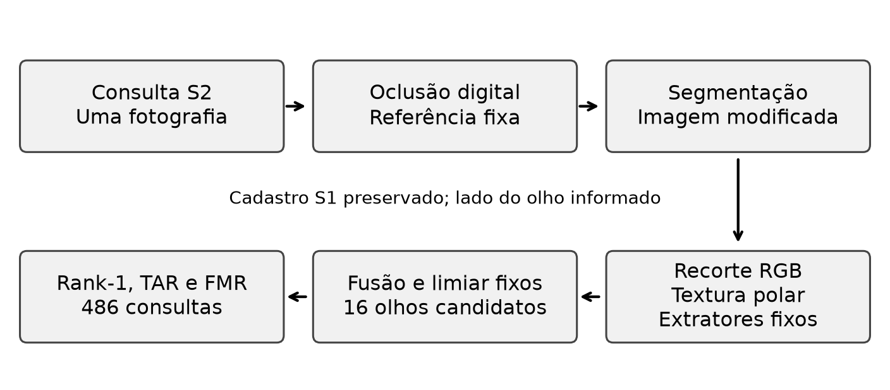
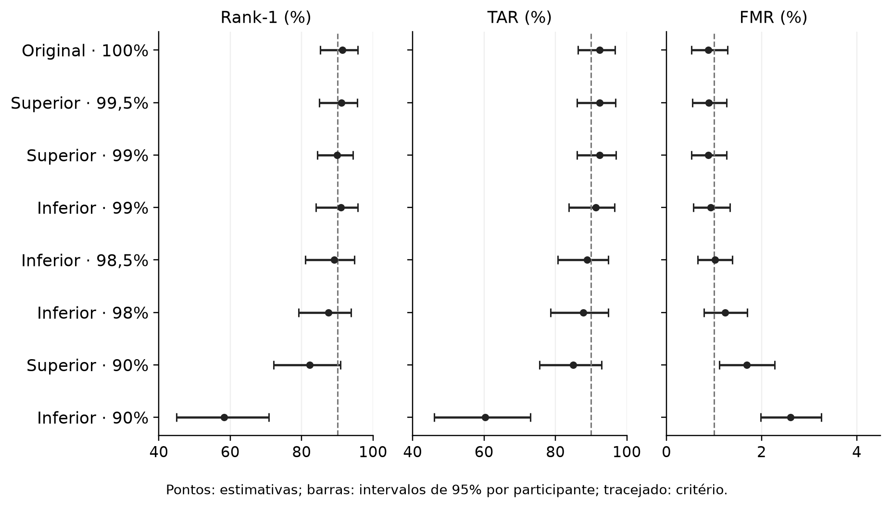

<!-- pagina:01 -->
# INFLUÊNCIA DA ÁREA PRESERVADA DA ÍRIS NA IDENTIFICAÇÃO OCULAR SOB OCLUSÕES CONTROLADAS

Lucas Cardoso Rodrigues

Rodrigo Ramos Silva

**Resumo:** Este estudo investigou a menor fração observada do suporte visível de íris que manteve critérios biométricos definidos sob oclusões superiores e inferiores. Utilizou-se o UBIPr segmentado, com partições por pessoa, extração automática e fusão de nove representações. O protocolo entre sessões manteve uma fotografia por consulta, lateralidade informada e dezesseis candidatos do mesmo lado. Nas 486 consultas do teste histórico, o sistema congelado obteve identificação Rank-1 de 91,36%, aceitação genuína de 92,39% e falsa correspondência empírica de 0,88%. Na grade irregular investigada, as menores frações nominais aprovadas foram 99,5% na orientação superior e 99% na inferior, relativas à região previamente visível anotada. A perda de 10% produziu respostas distintas conforme a posição. Ensaios posteriores de segmentação diversa e adaptação visual SAM3.1 não atingiram conjuntamente os critérios de prontidão. A extensão clínica incluiu nove imagens com alterações explícitas da íris; dois olhos forneceram quatro consultas, insuficientes para estimar um efeito clínico geral. A revisão dirigida da literatura distinguiu o requisito normativo de área utilizável de 70% de uma garantia universal de identificação. Recortes de controles e casos com alterações ilustraram ganhos locais e falhas persistentes de transferência. Concluiu-se que os limites encontrados caracterizam o sistema e as condições avaliadas, sem estabelecer mínimo anatômico universal ou equivalência entre oclusão sintética e patologia. A reutilização dos conjuntos no desenvolvimento restringe a independência das conclusões.

**Palavras-chave:** Biometria da íris. Segmentação. Área visível. Oclusão controlada. Anomalias oculares.

<!-- pagina:02 -->
## 1 INTRODUÇÃO

A identificação pela íris depende da capacidade de extrair informação que diferencie olhos a partir de imagens sujeitas a variações de captura. Uma fotografia pode apresentar grande parte da região ocular e, ainda assim, fornecer pouca textura aproveitável. Reflexos, desfocamento, movimento, pálpebras, cílios e erros de segmentação podem modificar a representação antes da comparação. Por isso, perguntar quanto da íris é necessário exige definir o que se considera área, quais imagens são comparadas e qual desempenho precisa ser mantido.

A relação entre disponibilidade visual e identificação é especialmente relevante quando existem alterações oculares. Uma opacidade pode dificultar a observação sem remover tecido da íris; uma mudança pupilar pode alterar a geometria sem produzir uma perda proporcional de textura; uma lesão pode afetar regiões com importância discriminativa diferente. A medida de área, isoladamente, não descreve todos esses mecanismos. O estudo de oclusões digitais oferece uma intervenção controlável para examinar parte do problema, desde que seus limites sejam mantidos explícitos.

O problema investigado foi formulado da seguinte maneira: qual é a menor fração nominal preservada da região visível de íris definida pelo protocolo que mantém critérios biométricos estabelecidos em um sistema de identificação entre sessões, sob perdas superiores e inferiores? Essa formulação delimita uma grandeza observável. Uma resposta obtida em determinado sensor, população e algoritmo não é automaticamente válida para todos os reconhecedores ou para todas as patologias.

O objetivo geral consistiu em estimar o limite observado desse sistema e examinar a dependência da posição da perda. Como objetivos específicos, organizaram-se partições por pessoa e lateralidade, reconstruíram-se a segmentação e os extratores de identidade, congelaram-se cadastro e limiar, aplicaram-se intervenções determinísticas e compararam-se as decisões com falhas preservadas nos denominadores. Acrescentaram-se uma avaliação de novos segmentadores e uma extensão clínica exploratória para identificar dificuldades de transferência.

A justificativa está na necessidade de distinguir tolerância real do processamento de uma interpretação simplificada do percentual visível. Sistemas biométricos precisam equilibrar reconhecimento genuíno e controle de falsas correspondências; aumentar somente a taxa de acertos, sem observar os erros entre identidades, pode gerar uma avaliação incompleta. O trabalho contribui ao apresentar resultados condicionados ao protocolo e ao registrar também hipóteses que não sustentaram melhoria conjunta.

<!-- pagina:03 -->
O estudo adotou abordagem quantitativa, com dados públicos, intervenções digitais de quantidade conhecida e comparações pareadas. A avaliação principal utilizou a versão segmentada de olhos individuais do UBIPr, apropriada à investigação de imagens em luz visível. O cadastro reuniu fotografias da primeira sessão, enquanto as fotografias da segunda sessão foram utilizadas como consultas. A lateralidade informada restringiu cada busca a dezesseis olhos do mesmo lado, mantendo esse universo fixo nas comparações.

Essa definição é relevante porque identificação e verificação respondem a perguntas diferentes. A identificação ordena candidatos e verifica se o olho correto aparece em primeiro lugar. A aceitação compara um escore a um limiar. O sistema pode aceitar o genuíno e, simultaneamente, atribuir escore ainda maior a outro candidato. A análise reuniu essas medidas e registrou o evento conjunto de identificar corretamente e aceitar, evitando tratar resultados distintos como uma única acurácia.

A primeira etapa consolidou o reconhecedor e examinou o efeito de oclusões artificiais. Em seguida, foram investigadas mudanças de segmentação, geometria e representação. As rodadas com SAM3.1 ocorreram em ambiente separado e foram avaliadas com os componentes de identidade preservados. Essa sequência permitiu verificar se uma máscara visualmente mais atraente, ou um Dice maior em determinadas condições, se convertia em uma melhoria do comportamento biométrico completo.

A extensão clínica utilizou imagens SLP-VLD com rótulos distribuídos pelos autores da base. A inclusão desses casos possibilitou discutir alterações anatômicas e diferenças de aquisição, mas não constituiu estudo causal sobre doenças. Não havia controles saudáveis do mesmo olho, nos mesmos momentos e com aquisição equivalente, suficientes para separar o efeito de uma patologia de outros fatores. A demonstração posterior por câmera de celular também permaneceu separada da avaliação acadêmica principal.

<!-- pagina:04 -->
## 2 PROCEDIMENTOS EXPERIMENTAIS
### 2.1 MATERIAIS
#### 2.1.1 Fundamentos da segmentação ocular

A segmentação estabelece quais pixels serão apresentados aos extratores de identidade. Na íris, esse processamento deve distinguir a região iridiana das estruturas vizinhas e das partes que não fornecem textura comparável. A pupila é uma região central diferente da íris, enquanto pálpebras, cílios e reflexos podem interromper sua observação. Uma máscara extensa pode incorporar suporte indevido, e uma máscara pequena pode eliminar informação discriminativa. A qualidade precisa ser examinada em relação a uma referência e ao efeito na cadeia posterior.

O processamento clássico apresentado por Daugman (2004; 2007) relaciona localização, normalização, codificação e comparação. O reconhecimento não resulta apenas de recortar um círculo na imagem: a representação precisa manter correspondência entre regiões de capturas diferentes. Essa organização orientou a separação entre máscara, geometria e descritor neste projeto, embora o reconhecedor implementado não reproduza integralmente o algoritmo clássico nem herde suas taxas de desempenho.

A U-Net oferece uma arquitetura de codificação e decodificação com conexões entre níveis espaciais, permitindo recuperar detalhes da segmentação a partir de representações de diferentes escalas (Ronneberger; Fischer; Brox, 2015). A variante local utilizou base reduzida e treinamento supervisionado com as classes disponíveis no UBIPr. As anotações da base foram utilizadas no ajuste e na avaliação da segmentação; a região predita, e não a referência manual, restringiu a extração operacional de identidade.

Modelos de fundação ampliam a possibilidade de produzir propostas de objetos a partir de diferentes tipos de entrada. O SAM introduziu uma segmentação orientada por prompts com ampla capacidade de transferência (Kirillov et al., 2023). Entretanto, localizar uma região visualmente coerente não resolve automaticamente a definição biométrica de íris utilizável. Uma proposta pode incluir a pupila ou confundir regiões com brilho e opacidade, exigindo avaliação específica no domínio.

<!-- pagina:05 -->
#### 2.1.2 Representação da textura e reconhecimento parcial

Após a segmentação, a textura pode ser representada no domínio original ou em coordenadas normalizadas. O recorte RGB preserva características de cor e relações locais da imagem, enquanto uma faixa polar procura estabelecer correspondência entre posições radiais e angulares. Essas representações são complementares, mas ambas dependem da localização. Uma geometria inconsistente pode deslocar estruturas de textura e produzir diferenças artificiais entre fotografias do mesmo olho.

Daugman (2007) discute métodos de normalização e comparação que consideram regiões utilizáveis do par. Hollingsworth, Bowyer e Flynn (2009) mostram que partes de um código de íris apresentam estabilidade desigual. Assim, a hipótese de que todos os pixels sejam intercambiáveis não é adequada: perder uma região pode produzir efeito diferente de perder a mesma quantidade em outra posição, mesmo antes de considerar falhas adicionais da segmentação.

Du et al. (2005) investigaram reconhecimento parcial com um método unidimensional e diferentes regiões. Os percentuais frequentemente associados àquele estudo precisam ser interpretados com seu protocolo: os exemplos de 40% na parte interna e 65% na externa relacionam-se a 95% em rank-10, e as divisões em anéis usam fração radial, não necessariamente área anular. A geometria também utiliza informação da imagem completa. Esses resultados não equivalem a identificação rank-1 garantida a partir de uma fotografia parcialmente observada.

Na abordagem adotada neste trabalho, diferentes redes produzem vetores comparáveis por similaridade. ResNet fornece conexões residuais para treinamento profundo (He et al., 2016), ConvNeXt revisita escolhas de arquitetura convolucional (Liu et al., 2022), e a margem angular empregada no aprendizado de identidade possui relação com a formulação ArcFace (Deng et al., 2019). A utilização dessas ideias não transfere automaticamente resultados de reconhecimento facial para reconhecimento de íris.

A revisão de Nguyen et al. (2024) contextualiza a diversidade de bases, representações e condições de aquisição. Melhorias locais precisam ser acompanhadas de avaliação com cadastro, consultas, universo de candidatos e critério de erro definidos.

<!-- pagina:06 -->
#### 2.1.3 Área visível e qualidade normativa

A ISO/IEC 29794-6:2015 estabelece métodos e requisitos relacionados à qualidade de imagens de íris. Na cláusula 6.2.1.4 consultada em material público, o indicador de área utilizável possui limiar de 70. Sua referência é um anel aproximado delimitado pela pupila e pelo limbo, e não a região de uma fotografia arbitrariamente escolhida como recorte. O requisito não constitui uma garantia de identificação para qualquer reconhecedor (ISO/IEC, 2015).

Neste estudo, a fração nominal preservada utiliza outro denominador: os pixels que já pertenciam à região visível anotada na fotografia original. Se parte da anatomia estiver inicialmente coberta pelas pálpebras, essa parcela não entra no suporte anotado. Manter 100% desse suporte significa apenas não acrescentar perda artificial. A diferença impede comparar diretamente a fronteira experimental com um valor normativo de área do anel.

Um exemplo hipotético esclarece a relação. Se uma fotografia expõe 80% de um anel e uma intervenção retém 70% dessa parte, a fração resultante é 56% do mesmo anel, desde que geometria e denominador permaneçam fixos. A operação não descreve um resultado biométrico do projeto. Ela mostra por que percentuais semelhantes podem representar grandezas diferentes e por que a base de cálculo precisa acompanhar qualquer conclusão.

Tabela 1 - Definições de área empregadas na interpretação

| Grandeza | Referência | Uso neste estudo |
|---|---|---|
| Área utilizável normativa | Anel estimado entre pupila e limbo | Contexto de qualidade da captura |
| Fração nominal preservada | Suporte visível originalmente anotado | Intervenção digital controlada |
| Suporte polar | Grade e máscara automáticas do extrator | Diagnóstico computacional |
| Área comum ao par | Interseção após alinhamento | Conceito de informação comparável |

Fonte: elaboração do autor (2026), com base em ISO/IEC (2015) e Daugman (2007).

Os relatórios IREX tratam qualidade, falhas de aquisição e desempenho como dimensões relacionadas, mas dependentes da implementação e do protocolo (Tabassi; Grother; Salamon, 2011; Quinn et al., 2014). A norma de avaliação biométrica também exige situar a medição no cenário de teste (ISO/IEC, 2021). Neste artigo, os 70% são uma referência contextual; não foi implementado um ensaio de conformidade com todos os requisitos normativos.

<!-- pagina:07 -->
#### 2.1.4 Evidências sobre alterações oculares

A literatura já investiga a confiabilidade da íris em condições oculares alteradas. Roizenblatt et al. (2004) estudaram reconhecimento após cirurgia de catarata. Aslam, Tan e Dhillon (2009) examinaram 54 pacientes com doenças oculares e relataram comportamentos diferentes entre condições. Dhir et al. (2010), em uma amostra menor, distinguiram efeitos associados à cirurgia e à dilatação. Esses trabalhos não sustentam a atribuição de um efeito único a toda alteração ocular.

Trokielewicz, Czajka e Maciejewicz (2015; 2017) avaliaram olhos afetados por patologias, incluindo dificuldades de segmentação e diferenças entre reconhecedores. O estudo publicado em 2017 envolve 230 olhos, dos quais 184 afetados, e quatro métodos de reconhecimento. Sua contribuição mostra que a falha observada pode depender da interação entre anatomia, imagem e processamento, e não somente da quantidade de região visualmente disponível.

Nigam et al. (2019) investigaram alterações antes e depois de cirurgia de catarata com diferentes sensores. Seyeddain et al. (2014) também examinaram reconhecimento após facoemulsificação e dilatação medicamentosa. A comparação desses estudos exige considerar momento da aquisição, tamanho pupilar e possibilidade de novo cadastro. Percentuais de êxito de diferentes populações e equipamentos não foram combinados como se estimassem a mesma medida.

Frasca e La Torre (2024) propuseram adaptar a geometria para íris com patologia, incluindo coloboma. O ganho de 32% destacado naquele trabalho refere-se ao erro de segmentação, não a uma taxa de identificação do nosso sistema. Hofbauer et al. (2016) também mostram que a qualidade de uma máscara, expressa isoladamente, não determina de forma confiável o desempenho da cadeia inteira. A parametrização e a consistência entre capturas precisam ser consideradas.

Como antecedente recente, Pessaud et al. (2026) analisaram área visível, dilatação e oclusão com OpenIRIS em infravermelho próximo, em 414 participantes e 827 íris. A área é expressa como contagem de pixels de máscara, com correções de segmentação e exclusões documentadas. A população não representa olhos com alterações relevantes que prejudiquem a imagem. A evidência é próxima ao tema, mas não estabelece um corte clínico universal transferível para captura RGB.

A revisão aqui empregada é dirigida, não sistemática nem metanalítica. Incluiu normas, relatórios técnicos e artigos sobre área parcial, qualidade e patologias. Sua função foi delimitar conceitos e posicionar os resultados próprios. Versões preliminares e publicadas do mesmo estudo não foram tratadas como experimentos independentes, e conclusões acessíveis apenas em resumos não foram ampliadas para detalhes metodológicos indisponíveis.

<!-- pagina:08 -->
#### 2.1.5 Bases e populações avaliadas

Utilizou-se a versão Single Eyes Segmented do UBIPr, que disponibiliza imagens em luz visível com a região ocular em enquadramentos variados. A descrição oficial caracteriza a base como apropriada a estudos perioculares e solicita a citação de Padole e Proença (2012). O projeto utiliza segmentação para restringir o suporte, mas admite que erros da máscara possam introduzir informação não iridiana. Por isso, os resultados são atribuídos ao sistema de identificação ocular assistido por segmentação.

As pessoas foram separadas entre treino, validação e teste, mantendo os dois olhos de cada participante na mesma partição. A unidade de identidade foi definida pela combinação entre pessoa e lateralidade. Para a avaliação biométrica entre sessões, consideraram-se os olhos com fotografias tanto na primeira quanto na segunda sessão. Essa elegibilidade produz populações menores que aquelas utilizadas para segmentação, como mostra a Tab. 2.

Tabela 2 - Populações do manifesto local

| Etapa | Pessoas | Imagens | Cadastro | Consultas |
|---|---:|---:|---:|---:|
| Treino de segmentação | 183 | 7.716 | Não se aplica | Não se aplica |
| Validação de segmentação | 39 | 1.652 | Não se aplica | Não se aplica |
| Teste de segmentação | 39 | 1.650 | Não se aplica | Não se aplica |
| Validação biométrica pareada | 16 | 962 | 480 | 482 |
| Teste biométrico pareado | 16 | 960 | 474 | 486 |

Fonte: do autor (2026), a partir do manifesto e das auditorias preservadas.

As imagens clínicas vieram do SLP-VLD, versão 3, com rótulos e códigos fornecidos no depósito (Qian, 2026). A seleção de alterações explícitas da íris e o emparelhamento longitudinal são descritos nos métodos. As imagens com rótulo Normal eye foram usadas como controles ilustrativos da mesma base; esse rótulo não corresponde a uma nova avaliação médica realizada pelo projeto.

O UBIPr é disponibilizado sob CC BY-NC-SA 4.0; as composições derivadas mantêm atribuição e uso acadêmico não comercial. O SLP-VLD consultado utiliza CC BY 4.0. Foram preservados os créditos das imagens e das transformações. Fotografias pessoais capturadas no demonstrador de celular não foram incorporadas às figuras deste artigo nem utilizadas para ampliar os denominadores dos experimentos.

<!-- pagina:09 -->
#### 2.1.6 Recursos computacionais e componentes

Os experimentos foram executados em Windows, com Python 3.12 e uma GPU NVIDIA RTX 3050 Laptop de 6 GB. O conjunto de pesos, dados e dependências foi preservado com hashes. O ambiente histórico de reconhecimento e o ambiente preparado para SAM3.1 permaneceram separados, evitando atualizar uma rodada ativa durante sua execução. A compatibilidade foi verificada em relação às distribuições CUDA efetivamente disponíveis para a máquina.

Tabela 3 - Componentes utilizados e papéis na avaliação

| Componente | Entrada | Papel |
|---|---|---|
| U-Net local | RGB | Máscara automática de referência operacional |
| Extrator visual SAM3.1 | RGB e características visuais | Sinal congelado para decodificador adaptado |
| Encoders RGB e ResNet50 | Recortes 128 ou 224 pixels | Representação de identidade |
| Encoder polar e mapa espacial | Faixa 64 × 512 | Textura normalizada e correspondência local |
| ConvNeXt e transformer polar | RGB ou faixa polar | Representações complementares |
| ArcIris em duas vistas | Faixas CLAHE e canal vermelho | Descritores externos preservados |

Fonte: do autor (2026), conforme configurações dos treinamentos e da fusão.

Na atualização consultada em novembro, o código oficial SAM 3 foi fixado na revisão f1647e8 e o checkpoint SAM3.1 na revisão daa6319 (Meta AI, 2026). A execução utilizou PyTorch 2.14.1+cu130 e torchvision 0.29.1+cu130. Foram consideradas as builds para Windows, o requisito NumPy menor que 2 do SAM e a inferência que funcionou no equipamento. O reconhecedor aberto da CVRL (2026) foi mantido como referência de implementação.

O uso de checkpoints externos não assegura conhecimento completo da população de pré-treinamento. A separação local por pessoa é verificável nos manifestos, mas não permite auditar toda origem dos modelos de fundação e do ArcIris. Essa limitação foi mantida na interpretação, e os resultados não foram descritos como independência absoluta em relação a todo dado potencialmente visto por qualquer modelo utilizado.

<!-- pagina:10 -->
### 2.2 MÉTODOS
#### 2.2.1 Desenvolvimento e congelamento do protocolo

O desenvolvimento separou ajuste de parâmetros, escolha de configuração e avaliação das condições de área. As identidades de treino forneceram gradientes aos extratores locais. A validação orientou checkpoints e decisões sobre lateralidade, representações e fusão. Após essa seleção, os pesos, o cadastro, as estatísticas de padronização e o limiar foram mantidos fixos durante as intervenções que definiram a fronteira principal.

A composição final reuniu sete componentes compartilhados e duas vistas ArcIris. A configuração empregou similaridades de identidade e uma normalização por consulta, com limiar congelado em 0,8581747485460748. Esse valor pertence ao cenário acadêmico com universo de candidatos definido; ele não foi ajustado para fazer uma oclusão específica passar. As contagens e as falhas foram preservadas mesmo quando a condição produziu piora.

O modelo RGB de identidade herdou o treinamento com margem angular em recortes de referência. A adaptação posterior para recortes automáticos incluiu a época zero como controle e não substituiu esse ponto inicial. O encoder polar selecionou a época 20; as ResNet50 de 128 e 224 pixels selecionaram as épocas 21 e 11; ConvNeXt selecionou a época 18; e o transformer polar selecionou a época 16. Esses resultados são decisões de desenvolvimento documentadas, não ensaios independentes entre si.

O conjunto de teste já havia sido examinado por estratégias anteriores na reconstrução do projeto. A separação por pessoa reduz a sobreposição direta de identidades no ajuste local, mas não elimina o viés de decisões tomadas após resultados previamente observados. A rodada principal é, portanto, exploratória. O congelamento preserva a comparação entre intervenções, sem transformar retroativamente o teste em confirmação cega.

Os ensaios posteriores de segmentação também adotaram critérios registrados antes de suas respectivas avaliações. A seleção dos candidatos utilizou segmentação; o reconhecimento foi medido depois com os componentes preservados. Quando um candidato reprovou sem oclusão, sua grade completa não foi aberta para buscar retrospectivamente um percentual favorável. Essa condição de avanço evitou atribuir mínimo de área a um sistema que já não sustentava o desempenho exigido na fotografia original.

As configurações e cópias de código acompanharam cada rodada. A integridade de um checkpoint foi distinguida da igualdade de seus tensores: serializações diferentes podem produzir hashes diferentes para o mesmo estado, sem representar melhoria científica.

<!-- pagina:11 -->
#### 2.2.2 Segmentação e normalização operacional

A U-Net de referência recebeu imagens RGB redimensionadas para 320 × 240 pixels. A máscara predita foi mapeada de volta à resolução original por interpolação de vizinho mais próximo, preservando rótulos discretos. O exterior foi removido antes do recorte, com uma margem de contexto em torno da caixa da região prevista. A fotografia original forneceu os pixels de textura; a máscara de referência não foi utilizada para corrigir manualmente a extração de uma consulta.

Figura 1 - Etapas do experimento principal com parâmetros congelados

Fonte: do autor (2026). A quantidade de 486 consultas refere-se ao teste histórico.

A faixa polar foi construída a partir de uma geometria automática elíptica, com contraste local no canal de intensidade e uma segunda vista no canal vermelho. Posições sem suporte da máscara receberam intensidade neutra. O fallback geométrico utiliza o centro da caixa da máscara e uma escala proporcional à sua extensão; ele não é uma anotação anatômica independente da pupila. Sua estabilidade também faz parte do problema avaliado.

As transformações de recorte produziram entradas de 128 × 128 e 224 × 224 pixels para redes RGB, além de faixas de 64 × 512 pixels para os extratores polares. O redimensionamento procura padronizar a entrada computacional, mas não recupera detalhes ausentes na aquisição. Reflexos ou tecido encoberto continuam sem informação original correspondente, mesmo que a máscara forme uma região visualmente regular.

Máscaras vazias ou faixas sem suporte não foram removidas silenciosamente das métricas. A extração inválida produziu uma falha registrada, mantida no denominador da consulta. Essa decisão evita que uma condição difícil aparente melhora apenas por excluir imagens nas quais o método deixou de funcionar. A disponibilidade do cadastro também foi verificada: sem representação genuína válida, a comparação correta pode ficar indisponível antes de qualquer limiar ser aplicado.

<!-- pagina:12 -->
#### 2.2.3 Representações e fusão de identidade

Os descritores globais foram normalizados e comparados por similaridade. Para cada olho cadastrado, a agregação considerou as três maiores similaridades por componente, ou todas quando havia menos de três fotos disponíveis. O componente espacial utilizou o protótipo médio dos mapas locais, normalizado por posição. As duas vistas ArcIris foram calculadas a partir das faixas CLAHE e vermelha, preservando os pesos externos registrados.

Tabela 4 - Nove componentes da fusão congelada

| Grupo | Componentes | Informação de entrada |
|---|---|---|
| RGB | ResNet18 RGB, ResNet50 e ConvNeXt | Recorte automático de cor |
| RGB nativo | ResNet50 nativo224 | Recorte com maior resolução de entrada |
| Polar | ResNet18 polar e transformer polar | Faixa normalizada |
| Espacial | Mapa local do encoder polar | Concordância por posição |
| Externo | ArcIris CLAHE e ArcIris vermelho | Duas vistas da mesma geometria |

Fonte: do autor (2026), a partir da ordem dos componentes no protocolo.

As médias e os desvios de cada componente foram estimados no desenvolvimento e congelados. A fusão preservou os pesos relativos entre os sete componentes compartilhados e as duas vistas externas. A normalização por consulta foi aplicada ao universo fixo de candidatos do protocolo. Sua função é parte da definição do escore, e não uma garantia de que ele expresse probabilidade calibrada de identidade.

O transformer polar é uma adaptação de seis blocos de um ViT-L/16 DINOv3, com projeção para 256 dimensões. Os tokens de classificação e de registro não participam da saída espacial. A designação DINOv3 identifica a origem do modelo, mas a configuração local é mais restrita que o modelo completo (Siméoni et al., 2025). O classificador usado no treino representa as identidades de ajuste; as identidades de avaliação entram pela comparação com os cadastros, não por esse classificador.

A lateralidade foi informada e mantida fixa. Um olho esquerdo não foi tratado como genuíno de um olho direito da mesma pessoa. Nas buscas principais, cada consulta comparou dezesseis olhos do mesmo lado. Alterar o tamanho ou a composição dessa galeria pode modificar a distribuição dos escores e a dificuldade de identificação. Por essa razão, o limiar acadêmico não foi transferido automaticamente para o demonstrador móvel com cadastro pequeno e variável.

<!-- pagina:13 -->
#### 2.2.4 Intervenções de área e localização da perda

As oclusões foram definidas pela máscara de referência da fotografia original, exclusivamente para determinar a quantidade e a posição dos pixels substituídos. Para uma referência com N pixels, a quantidade removida foi obtida por arredondamento da perda nominal multiplicada por N. A fração efetivamente preservada foi calculada pela Eq. 1. Quando N era zero, não se definiu fração de área e a fotografia permaneceu inalterada.

Eq. 1 - A = 100 × (N − n)/N, para N > 0.

Na orientação superior, a seleção percorreu as linhas de cima para baixo; na inferior, de baixo para cima. Empates na mesma linha seguiram a posição horizontal. Os pixels selecionados receberam cinza de intensidade 128, enquanto o restante da fotografia permaneceu igual. A referência original foi mantida em todos os níveis, evitando que uma máscara automática pior sob oclusão mudasse a quantidade nominal da própria intervenção.

Tabela 5 - Grade histórica de perda adicional investigada

| Orientação | Perdas nominais avaliadas | Áreas nominais correspondentes |
|---|---|---|
| Superior | 0%; 0,5%; 1%; 10% | 100%; 99,5%; 99%; 90% |
| Inferior | 0%; 1%; 1,5%; 2%; 10% | 100%; 99%; 98,5%; 98%; 90% |

Fonte: do autor (2026). Grade irregular; não houve interpolação entre níveis.

A primeira busca examinou perda de 10% e interrompeu a redução de área na primeira reprovação. Um refinamento posterior considerou perdas inteiras e, por fim, dois pontos adicionais previamente limitados: 0,5% na parte superior e 1,5% na inferior. As condições desses dois pontos foram executadas independentemente do êxito da primeira, com cadastro, pesos e limiar preservados.

A fronteira observada foi definida pelo prefixo de áreas testadas que permaneceram aprovadas, partindo da condição original. Não se supôs monotonicidade entre pontos não avaliados. A ausência do nível inferior de perda de 0,5% impede afirmar que 99,5% tenha sido aprovado nas duas orientações. O arredondamento por fotografia também produz pequenas diferenças entre quantidade nominal e efetiva, sem alterar a definição do denominador.

A intervenção cria uma perda digital mensurável para comparação pareada. Não reproduz inflamação, opacidade, deformação pupilar ou tratamento. Sua relação com alterações reais permanece dependente de dados e referências clínicas apropriados.

<!-- pagina:14 -->
#### 2.2.5 Métricas e análise de incerteza

O Rank-1 corresponde à proporção de consultas em que o olho genuíno ocupa a primeira posição. A taxa de aceitação genuína, ou TAR, corresponde à proporção de consultas cujo escore genuíno atinge o limiar. A falsa correspondência, ou FMR, é a proporção de comparações entre olhos diferentes que ultrapassam esse mesmo limiar. As Eq. 2 a 4 apresentam as definições operacionais com seus denominadores.

Eq. 2 - Rank-1 = identificações corretas / total de consultas.

Eq. 3 - TAR = comparações genuínas aceitas / total de consultas.

Eq. 4 - FMR = comparações impostoras aceitas / total de comparações impostoras.

O teste histórico manteve 486 consultas e 7.290 comparações impostoras. Na validação pareada, os denominadores foram 482 e 7.230, respectivamente. Falhas de extração permaneceram no total de consultas e não foram transformadas em fração válida de área. A proporção conjunta de identificar corretamente e aceitar foi registrada separadamente, pois os eventos isolados podem ocorrer em consultas diferentes.

O critério principal exigiu Rank-1 e TAR de pelo menos 90%, com FMR de até 1%. Trata-se de uma escolha operacional do estudo, não de um requisito clínico universal. Nas rodadas de prontidão mais recentes, acrescentou-se a exigência de pelo menos 90% para o acerto aceito simultâneo. A mudança foi registrada por rodada e não foi aplicada retroativamente para alterar a classificação do teste histórico.

A incerteza foi estimada por 5.000 reamostragens de participantes com reposição. Cada sorteio manteve as consultas da pessoa selecionada e foi compartilhado pelas condições comparadas. O cadastro e o limiar ficaram fixos. Os percentis das distribuições reamostradas produziram intervalos descritivos de 95%. A aprovação nos limites foi decidida por contagens inteiras, evitando que arredondamentos de porcentagens alterassem o resultado.

Esses intervalos não corrigem todo viés de seleção ou comparações múltiplas. A frequência de reamostras aprovadas não é uma probabilidade posterior de sucesso populacional. Tampouco um intervalo pontual valida simultaneamente a fronteira de todos os níveis. A análise foi utilizada para contextualizar a fragilidade de decisões próximas ao limite, sem substituir a confirmação que exigiria pessoas e capturas reservadas para uma avaliação independente.

A FMR por comparação difere do risco em uma busca 1:N, influenciado pelo número de candidatos e pelas dependências entre comparações. A unidade medida e o cenário permanecem explícitos (ISO/IEC, 2021; Quinn; Grother; Matey, 2018).

<!-- pagina:15 -->
#### 2.2.6 Ensaios posteriores e extensão clínica

Os novos segmentadores foram selecionados por desempenho de segmentação nas condições original, zoom, vista oblíqua e óculos sintéticos. No SAM3.1 supervisionado, o extrator visual permaneceu congelado e o decodificador recebeu ajuste com dados de treino. A continuação com negativos internos aumentou o peso de regiões já anotadas como não íris dentro de contornos; não criou uma referência anatômica de pupila. O modelo residual posterior manteve o anterior congelado e limitou a correção adicionada à saída.

As avaliações de identidade utilizaram os nove componentes, pesos e limiar preservados. A grade de área das rodadas recentes foi condicionada à aprovação sem perda adicional. Todas as consultas foram mantidas, com análise separada das referências de área definidas e indefinidas. Essa regra impediu usar resultados de identidade ou anotações clínicas para escolher um checkpoint de segmentação e depois apresentá-lo como se tivesse passado por confirmação independente.

Na extensão clínica, incluíram-se todas as nove imagens com menção explícita a íris ou iridodiálise no manifesto SLP-VLD. Elas representam oito olhos codificados. Dois tinham capturas repetidas elegíveis: P0114 OS e P0803 OD. A primeira captura de cada olho foi cadastro; as posteriores forneceram quatro consultas. Cada galeria incluiu o alvo e os primeiros quinze outros olhos elegíveis do mesmo lado, sem seleção por qualidade ou escore.

O conjunto processado reuniu 42 fotografias: 32 de cadastro, quatro consultas e seis casos adicionais sem cadastro elegível. A fusão e o limiar UBIPr foram transportados sem calibração clínica. Após observar as falhas, registrou-se um controle posterior de escala fixa de um terço para a entrada da U-Net, mantendo os pixels originais na extração e sem buscar a melhor escala por olho. Essa intervenção foi aplicada também ao cadastro.

As figuras clínicas foram escolhidas para mostrar recortes disponíveis com delimitação visual mais completa e, em separado, falhas relevantes. Essa seleção documental não é uma amostra aleatória nem estima prevalência ou qualidade média. As máscaras das figuras foram regeneradas em CPU com os mesmos pesos e o controle de escala; diferenças de borda em relação à execução histórica foram registradas na proveniência. As métricas originais não foram recalculadas nem substituídas para favorecer as ilustrações.

A etapa móvel utilizou cadastro próprio e testes funcionais de captura e comparação. Não modificou a fronteira principal nem recebeu as taxas de reconhecimento de outro domínio.

<!-- pagina:16 -->
## 3 RESULTADOS E DISCUSSÃO
### 3.1 REFERÊNCIA SEM OCLUSÃO ADICIONAL

A U-Net de referência completou trinta épocas, com seleção da época 26 pela validação. No teste de segmentação, o Dice da íris foi 0,9342 e o Dice médio das classes de primeiro plano foi 0,8944. Essas medidas utilizam as 1.650 imagens do teste de segmentação, e não apenas as 960 fotografias elegíveis para reconhecimento entre sessões. A diferença de população impede interpretar o Dice como uma previsão direta da taxa de identificação.

Tabela 6 - Desempenho histórico da fusão congelada

| Medida | Validação | Teste |
|---|---:|---:|
| Rank-1 | 434/482 - 90,04% | 444/486 - 91,36% |
| TAR | 437/482 - 90,66% | 449/486 - 92,39% |
| FMR | 71/7.230 - 0,9820% | 64/7.290 - 0,8779% |
| Correto e aceito | 426/482 - 88,38% | 436/486 - 89,71% |
| Falhas de extração | 4 | 2 |

Fonte: do autor (2026), a partir dos escores e das decisões históricas preservadas.

O teste passou os três critérios separados do protocolo principal. Entretanto, o evento conjunto de acertar e aceitar ficou em 89,71%. Essa diferença não invalida o critério originalmente registrado, mas delimita seu significado: obter pelo menos 90% em duas medidas marginais não implica obter 90% no evento simultâneo. A exigência conjunta adotada em rodadas posteriores é mais restritiva e não deve ser confundida com uma mudança retrospectiva do resultado.

A margem de aprovação do Rank-1 também é limitada. Entre 486 consultas, atingir 90% exige pelo menos 438 acertos; o original apresentou 444. A alteração de poucas decisões pode mudar a aprovação. Essa discretização demonstra que a fronteira não representa necessariamente uma transição anatômica abrupta: ela resulta da relação entre um critério pontual, uma população finita e o comportamento do processamento.

A condição original fornece o controle pareado para as intervenções. Como validação e teste foram consultados no desenvolvimento, suas diferenças não constituem uma estimativa sem viés da generalização.

<!-- pagina:17 -->
### 3.2 FRONTEIRAS NOMINAIS OBSERVADAS

Na grade investigada, a menor área nominal aprovada foi 99,5% na orientação superior e 99% na inferior. Os valores utilizam o suporte visível anotado de cada fotografia como referência. A Tab. 7 reúne os pontos que delimitam a aprovação e as condições de perda de 10%, mantendo todas as consultas e o limiar histórico.

Tabela 7 - Área nominal e desempenho no teste histórico

| Condição | Área | Rank-1 | TAR | FMR |
|---|---:|---:|---:|---:|
| Original | 100% | 91,36% | 92,39% | 0,8779% |
| Superior, perda de 0,5% | 99,5% | 91,15% | 92,39% | 0,8916% |
| Superior, perda de 1% | 99% | 89,92% | 92,39% | 0,88% |
| Inferior, perda de 1% | 99% | 90,95% | 91,36% | 0,93% |
| Inferior, perda de 1,5% | 98,5% | 89,09% | 88,89% | 1,0151% |
| Superior, perda de 10% | 90% | 82,30% | 84,98% | 1,69% |
| Inferior, perda de 10% | 90% | 58,23% | 60,29% | 2,61% |

Fonte: do autor (2026). Arredondamentos não substituem as contagens auditadas.

A condição superior com 99% preservados reprovou por Rank-1. Na inferior, 98,5% reprovou os três requisitos. As duas posições, portanto, não compartilharam a mesma fronteira nos níveis avaliados. Não se testou a perda inferior de 0,5%; anunciar uma fração comum de 99,5% aprovada nas duas orientações acrescentaria uma condição que não foi medida.

O resultado também não estabelece que uma íris humana precise conservar mais de 99% de sua anatomia para ser identificada. A intervenção removeu parte da região que já era visível e anotada, modificou a entrada do segmentador e permitiu que a geometria fosse recalculada. A cadeia pode se tornar instável com uma pequena alteração, mesmo quando grande parte da informação visual permanece na fotografia.

As referências vazias continuaram nos denominadores, sem receber uma fração anatômica artificial. A conclusão apropriada é uma fronteira observada de tolerância desse processamento, sob regras específicas de alteração e decisão. Ela pode orientar o diagnóstico do sistema e a formulação de ensaios posteriores, mas não representa uma constante biológica, um requisito clínico ou uma garantia de comportamento entre pontos não avaliados.

<!-- pagina:18 -->
### 3.3 POSIÇÃO DA PERDA E INCERTEZA

A perda adicional de 10% produziu uma diferença de Rank-1 de 24,07 pontos percentuais entre as orientações superior e inferior. O intervalo pareado descritivo de 95% foi de 10,83 a 36,25 pontos. A mesma quantidade nominal removida, portanto, resultou em respostas bastante diferentes neste processamento e neste conjunto de consultas.

Figura 2 - Desempenho e intervalos descritivos das condições históricas

Fonte: do autor (2026). Reamostragem por participante, com cadastro e limiar fixos.

A Figura 2 mostra que várias estimativas próximas à fronteira possuem incerteza relevante em torno dos limites operacionais. Uma condição pontualmente aprovada pode não apresentar uma frequência elevada de aprovação nas reamostragens. Os intervalos caracterizam variação amostral condicionada à galeria fixa, sem corrigir a seleção realizada durante o desenvolvimento nem fornecer garantia simultânea para toda a curva de área.

A diferença entre orientações pode refletir tanto informação discriminativa localizada quanto alterações na segmentação e na geometria. Não é possível atribuir os 24,07 pontos exclusivamente à importância anatômica de uma região. Como a máscara e a normalização foram recalculadas sobre a fotografia alterada, esses mecanismos fazem parte da resposta observada. Uma investigação de contribuição regional isolada precisaria controlar separadamente cada etapa.

<!-- pagina:19 -->
### 3.4 GEOMETRIA E ESTABILIDADE DO PROCESSAMENTO

Os diagnósticos posteriores procuraram explicar por que perdas pequenas podiam modificar o reconhecimento. A segmentação restringe a entrada, mas também fornece elementos para a estimação da geometria polar. Ao mudar o suporte previsto, a intervenção pode deslocar a parametrização e fazer uma estrutura aparecer em posições diferentes da faixa normalizada. A dificuldade deixa de ser apenas a ausência dos pixels substituídos e passa a incluir inconsistência no alinhamento da informação restante.

Um diagnóstico utilizou a geometria obtida da fotografia limpa para processar sua versão alterada. Houve recuperação de desempenho sob oclusão em condições examinadas. Entretanto, essa configuração depende da disponibilidade da captura original não ocluída, informação que não está presente no cenário operacional de uma única fotografia alterada. O resultado foi tratado como evidência sobre o mecanismo de falha, sem promover essa geometria assistida como solução de produção.

Também foram examinados ajustes de normalização de escores e adaptações de representação polar. Um limiar interno mais conservador controlou falsas correspondências, mas reduziu a aceitação genuína. Em uma verificação de validação limpa, o Rank-1 permaneceu em 90,46%, enquanto a TAR caiu para 64,32%, com FMR de 0,2075%. O resultado exemplifica por que diminuir falsas correspondências isoladamente não comprova uma melhoria equilibrada do sistema.

Outra tentativa trocou apenas a representação polar, preservando os parâmetros anteriores da fusão. Na validação limpa, produziu Rank-1 de 89,83%, TAR de 90,25% e FMR de 1,0235%. A reprovação impediu a abertura de novas oclusões para aquela configuração. Esses pilotos não entram na estimação da fronteira histórica, pois pertencem a estratégias diferentes e foram avaliados em conjuntos e momentos de desenvolvimento próprios.

As análises mostram que uma máscara mais extensa ou uma imagem polar visualmente mais contínua não garantem correspondência consistente. O suporte pode ser ampliado com pixels de pupila, reflexo ou estrutura vizinha. A interpretação precisa acompanhar o escore genuíno, os impostores e a disponibilidade do cadastro. Essa conclusão é coerente com a separação entre desempenho de segmentação e reconhecimento discutida por Hofbauer et al. (2016; 2019).

<!-- pagina:20 -->
### 3.5 SEGMENTAÇÃO DIVERSA E TRANSFERÊNCIA DE CAPTURA

A rodada de segmentação diversa procurou ampliar a tolerância a olhos em escalas e aparências diferentes, incluindo aumento sintético de escala, transformação oblíqua e óculos. O candidato final, selecionado na época 30, foi examinado com o reconhecedor preservado. Embora apresentasse melhorias em situações difíceis, não manteve o desempenho limpo necessário para substituir a referência operacional.

Tabela 8 - Validação biométrica da U-Net diversa

| Condição | Controle Rank-1 | Candidato Rank-1 | Candidato TAR | Candidato FMR |
|---|---:|---:|---:|---:|
| Original | 90,04% | 86,10% | 85,68% | 1,203% |
| Perda superior de 10% | 80,71% | 80,08% | 76,56% | 1,203% |
| Perda inferior de 10% | 59,96% | 70,33% | 70,95% | 2,254% |

Fonte: do autor (2026), rodada diversa; 482 consultas de validação em cada condição.

O ganho observado na perda inferior foi de 10,37 pontos percentuais de Rank-1 em relação ao controle dessa rodada. Entretanto, na condição original, ocorreu redução de 3,94 pontos. Melhorar uma condição e prejudicar outra não satisfaz um critério de preservação do funcionamento limpo. Como o candidato também reprovou a FMR na condição original, não foi atribuído um novo mínimo de área.

Esses resultados são da validação e não podem ser apresentados como melhora sobre os 91,36% do teste histórico. Além das populações diferentes, há particularidades de execução e preparação registradas por rodada. As comparações pareadas foram mantidas em seus próprios contextos. Não se combinaram a melhor identificação de um ensaio com a menor FMR de outro para construir um resultado que nenhum sistema efetivamente produziu.

A experiência também mostrou que diversidade de transformação não equivale à diversidade clínica. Óculos sintéticos e mudanças de enquadramento podem ampliar situações do treinamento, mas não acrescentam por si só as relações entre alterações da íris, córnea, pupila e tratamento presentes em imagens reais. O uso dessas transformações é uma estratégia de robustez de captura, cuja eficácia precisa ser medida, sem substituir dados clínicos anotados.

<!-- pagina:21 -->
### 3.6 ADAPTAÇÃO VISUAL DO SAM3.1

O primeiro treino supervisionado com características visuais SAM3.1 concluiu vinte épocas. A seleção registrada escolheu a época 15, maximizando o desempenho de segmentação sob as condições avaliadas e preservando o controle original. A Tab. 9 apresenta o Dice médio, calculado nas mesmas 1.652 imagens de validação em cada condição. O extrator visual permaneceu congelado; a adaptação foi realizada no decodificador supervisionado.

Tabela 9 - Segmentação no adaptador SAM3.1

| Condição | Época zero | Época 15 | Diferença em pontos percentuais |
|---|---:|---:|---:|
| Original | 86,09% | 88,62% | +2,53 |
| Zoom 3× | 83,18% | 86,51% | +3,34 |
| Oblíqua | 85,54% | 87,61% | +2,07 |
| Óculos sintéticos | 85,18% | 88,21% | +3,03 |

Fonte: do autor (2026), auditoria do treinamento concluído em 04/11/2026.

Houve melhora nas quatro condições em relação à época zero, mas nenhuma atingiu a meta de engenharia de 90%. O resultado não isola a contribuição causal das características SAM3.1: o ramo RGB também foi ajustado e a perda supervisionada participou do treinamento. Seria necessário um controle com o mesmo orçamento de épocas e a mesma perda, sem características de fundação, para atribuir a diferença somente ao SAM.

A auditoria recalculou métricas a partir das contagens de pixels e reproduziu a regra de seleção. Também investigou uma divergência de hash entre duas cópias serializadas do checkpoint. A igualdade dos 258 tensores e dos demais estados foi confirmada antes da reconciliação da cópia. A evidência evitou interpretar uma diferença de contêiner ou nome de arquivo como mudança real do modelo aprendido.

Os prompts semânticos diretos continuaram apresentando problemas em exemplos clínicos, incluindo escolha da pupila ou de fragmentos inadequados. A adaptação visual, portanto, não deve ser descrita como simples aplicação textual do SAM a uma fotografia. Trata-se de um sistema supervisionado local que reutiliza um extrator de fundação e exige sua própria avaliação de segmentação, geometria e reconhecimento.

A melhoria de sobreposição precisou ser confrontada com identidade e impostores. A etapa seguinte manteve os reconhecedores congelados para medir o efeito da nova máscara na decisão biométrica.

<!-- pagina:22 -->
### 3.7 NEGATIVOS INTERNOS E CORREÇÃO RESIDUAL

A continuação com negativos internos partiu da época 15 e enfatizou pixels já anotados como não íris em regiões internas dos contornos. A hipótese era reduzir inclusão indevida sem criar rótulos de pupila que não existiam de forma independente na base. Após quatro épocas sem ganho elegível, a seleção manteve a época zero. A comparação dos estados confirmou que os pesos selecionados continuaram iguais aos anteriores.

Esse resultado foi registrado como ausência de melhora, não como um novo segmentador. A alteração de metadados em um checkpoint não equivale a uma nova função de inferência. O fluxo também recebeu proteção para que uma falha de escrita do relatório de acompanhamento não encerrasse o trabalhador científico. A mudança operacional preservou dados, perda, seleção e fontes da rodada em curso.

Na etapa seguinte, implementou-se uma correção residual limitada, mantendo o modelo anterior congelado. A saída inicial foi conferida como equivalente ao controle, e a correção aprendida foi limitada antes de ser adicionada aos logits. O treinamento terminou após catorze épocas, com seleção da época 8. Essa organização procurou ajustar erros remanescentes sem permitir uma mudança irrestrita do modelo de base.

Tabela 10 - Validação da correção residual SAM3.1

| Condição | Dice médio | Meta de 90% |
|---|---:|---|
| Original | 88,65% | Não atingida |
| Zoom 3× | 86,65% | Não atingida |
| Oblíqua | 87,63% | Não atingida |
| Óculos sintéticos | 88,40% | Não atingida |

Fonte: do autor (2026), treinamento residual encerrado em 05/11/2026.

As diferenças em relação ao adaptador anterior foram pequenas e não mudaram o estado de prontidão. Mesmo a melhor condição ficou abaixo do alvo registrado. O resultado mostra que uma arquitetura mais complexa não resolveu automaticamente o problema de transferência, e que a seleção por uma média ou condição isolada poderia ocultar limitações presentes nas demais vistas.

O checkpoint selecionado foi preservado com SHA-256. Os testes de equivalência inicial, congelamento e carregamento estrito verificam a implementação, sem substituir o desempenho biométrico medido posteriormente.

<!-- pagina:23 -->
### 3.8 IDENTIDADE COM OS CANDIDATOS SAM3.1

A avaliação de identidade mostrou que os candidatos SAM3.1 não atingiram os critérios completos na condição original. A Tab. 11 reúne a validação limpa com os denominadores preservados. O controle utiliza o ambiente atualizado dessa comparação, e seus valores não devem ser trocados pelos números históricos de outra execução para construir uma vantagem artificial.

Tabela 11 - Reconhecimento limpo na comparação SAM3.1

| Segmentador | Rank-1 | TAR | Correto e aceito | FMR |
|---|---:|---:|---:|---:|
| U-Net original no controle | 90,04% | 90,46% | 88,38% | 0,996% |
| Adaptador, época 15 | 89,42% | 89,63% | 86,93% | 1,051% |
| Residual, época 8 | 89,42% | 89,63% | 87,34% | 0,927% |

Fonte: do autor (2026). Cada linha mantém 482 consultas e 7.230 comparações impostoras.

No residual, ocorreram 431 identificações corretas, 432 aceitações genuínas e 421 sucessos conjuntos. As falsas correspondências foram 67 entre 7.230 pares. A FMR ficou abaixo de 1%, mas Rank-1, TAR e sucesso conjunto não alcançaram 90%. As três falhas de extração continuaram nas consultas. A fronteira permaneceu vazia e nenhum novo mínimo foi atribuído a esse candidato.

Nas perdas de 10%, o residual apresentou Rank-1 de 84,02% na orientação superior e 81,12% na inferior, com FMR de 1,093% e 1,355%, respectivamente. São resultados da validação dessa rodada. A melhora relativa em uma oclusão não autoriza ignorar a reprovação sem oclusão, nem extrapolar um percentual de área clínica ou transferir o desempenho para uma câmera diferente.

O controle também reprovou o requisito conjunto mais restritivo, apesar de ultrapassar 90% nas duas medidas marginais. Isso reforça que uma decisão de prontidão depende da regra explicitamente escolhida, e não de um rótulo genérico de bom desempenho. Os critérios históricos e recentes foram mantidos separados para permitir interpretação honesta da evolução do projeto.

Esses resultados não aprovaram o avanço automático ao ensaio clínico de área mínima. O ganho visual em casos selecionados não substituiu os critérios quantitativos.

<!-- pagina:24 -->
### 3.9 RECORTES DE CONTROLES NORMAIS

A Figura 3 apresenta dois controles do SLP-VLD rotulados como Normal eye, com fotografia, máscara prevista e recorte automático. Foram escolhidos exemplos disponíveis com delimitação visual mais completa que os fragmentos produzidos pela apresentação original à U-Net. Ambos utilizam os mesmos pesos congelados e o controle fixo de escala, sem anotação manual usada na extração.

Figura 3 - Recortes selecionados de olhos com rótulo normal na base

Fonte: Qian (2026), SLP-VLD v3, CC BY 4.0. Máscaras, recortes e composição do autor.

Os exemplos mostram que o enquadramento apresentado ao segmentador pode alterar a extensão recuperada. O centro escuro, os reflexos e os limites da íris continuam exigindo conferência: a sobreposição verde representa a previsão do algoritmo, não uma referência anatômica validada. A presença de uma borda aproximadamente circular não demonstra que cada pixel interno corresponda à textura desejada.

O rótulo normal é o informado no depósito; não houve nova avaliação médica dos participantes. A seleção foi feita para ilustração da qualidade disponível e não para calcular uma média favorável. O reconhecimento desses controles não foi medido nesta composição. Assim, as figuras atendem à apresentação dos recortes sem criar uma taxa de acerto nem uma conclusão clínica que os dados não fornecem.

<!-- pagina:25 -->
### 3.10 RECORTES DE OLHOS COM ALTERAÇÕES

A Figura 4 reúne dois casos com alterações explicitamente registradas no SLP-VLD. O primeiro possui iridodiálise, catarata traumática e contusão ocular. O segundo possui sinéquias da íris, captura de lente intraocular e opacificação capsular posterior. Os rótulos são da base e podem incluir comorbidades; a composição não atribui um diagnóstico novo a partir da aparência.

Figura 4 - Recortes selecionados de íris em casos com alterações oculares

Fonte: Qian (2026), SLP-VLD v3, CC BY 4.0. Máscaras, recortes e composição do autor.

Os recortes preservam uma porção visualmente mais ampla da região iridiana que os fragmentos observados em diversas tentativas iniciais. Ainda existem interrupções associadas à máscara, ao reflexo e à geometria de aquisição. Sem referência clínica especializada, não é possível converter essa aparência em Dice verdadeiro, porcentagem de tecido remanescente ou garantia de uma extração adequada para identificação.

Esses dois olhos não forneceram cadastro longitudinal elegível no estudo de quatro consultas. Sua inclusão é documental e não acrescenta sucessos ao reconhecimento clínico. A distinção evita uma conclusão baseada apenas nas fotografias mais bem apresentadas. Os casos com falha também permanecem discutidos, e os resultados quantitativos continuam sendo aqueles obtidos no protocolo de identificação preservado.

<!-- pagina:26 -->
### 3.11 RECONHECIMENTO CLÍNICO LONGITUDINAL

O sistema original não identificou corretamente nenhuma das quatro consultas clínicas e não aceitou nenhum genuíno. Houve uma falsa correspondência entre sessenta pares impostores. Uma consulta tinha o cadastro genuíno indisponível por máscara vazia; as demais apresentavam representação computável, mas não produziram identificação e aceitação corretas. A Tab. 12 mantém as quatro consultas no denominador.

Tabela 12 - Resultados clínicos exploratórios com parâmetros congelados

| Execução | Rank-1 correto | Genuínos aceitos | Falsas correspondências | Genuíno indisponível |
|---|---:|---:|---:|---:|
| Original | 0/4 | 0/4 | 1/60 | 1/4 |
| Escala fixa de um terço | 1/4 | 1/4 | 2/60 | 3/4 |

Fonte: do autor (2026). Quatro consultas de dois olhos; não é estimativa populacional.

O controle de escala recuperou a consulta P0114, que passou a ser identificada e aceita com escore genuíno de 0,8753819683, acima do limiar congelado. Entretanto, a máscara do cadastro P0803 tornou-se vazia, indisponibilizando as três comparações genuínas daquele olho. O ganho local, portanto, coexistiu com prejuízo em outro cadastro e não justificou a promoção da escala como configuração clínica geral.

A proporção de um sucesso em quatro consultas é de 25%, mas não oferece precisão suficiente para descrever uma população de pessoas com alterações oculares. Além disso, as consultas repetidas de um mesmo olho não equivalem a quatro pessoas independentes. A pequena quantidade de pares impostores também limita a interpretação: uma única falsa correspondência já representa 1,67%, acima do alvo empírico de 1% adotado em outro cenário.

Não havia comparação saudável e doente do mesmo olho com aquisição equivalente. Mudaram iluminação, proximidade, opacidades, geometria e possíveis efeitos do tratamento. Consequentemente, o ensaio revela dificuldade de transferência da cadeia, sem isolar a contribuição causal de uma patologia. O código de identificação do depósito fornece o vínculo utilizado, mas não substitui confirmação independente por prontuário ou documentação clínica longitudinal completa.

Os resultados sustentam um requisito para a continuidade: validar a segmentação clínica e a elegibilidade dos pares antes de usar a máscara para medir anatomia. Caso contrário, uma redução do suporte previsto pode ser erroneamente interpretada como perda de tecido, quando o que ocorreu foi uma falha de localização ou indisponibilidade do cadastro.

<!-- pagina:27 -->
### 3.12 LIMITES VISUAIS E ÁREA ANATÔMICA

A Figura 5 contrasta o recorte do caso P0114, com cisto de íris e alterações corneanas, e a máscara vazia do cadastro P0803, com laceração e outras lesões. A apresentação conjunta impede que a seleção de exemplos mais completos oculte a falha que permaneceu no mesmo controle de escala.

Figura 5 - Ganho local e falha persistente no controle de escala

Fonte: Qian (2026), SLP-VLD v3, CC BY 4.0. Transformações do autor.

No caso recuperado, uma região ampla fornece pixels ao extrator, mas também pode incluir opacidade e reflexos. No cadastro vazio, não há representação genuína disponível para a comparação posterior. Essas duas situações demonstram por que disponibilidade de máscara, área de máscara e qualidade de identidade são grandezas relacionadas, porém distintas.

O suporte polar de 94,10% registrado na consulta recuperada não significa 94,10% da anatomia preservada. Ele mede posições válidas na grade estimada pelo próprio algoritmo. Uma geometria incorreta pode produzir suporte alto em uma região inadequada. Antes de utilizar qualquer percentual como extensão de anomalia, seria necessária uma referência clínica independente e uma definição anatômica verificável do denominador.

<!-- pagina:28 -->
### 3.13 DEMONSTRADOR EM CÂMERA DE CELULAR

Foi implementado um demonstrador privado para Samsung Galaxy S23 base, com Android 15 e processamento no Dell G15. O navegador recebe uma captura ou fotografia existente; o usuário enquadra um olho e o PC executa a cadeia biométrica. A comunicação por USB utiliza encaminhamento local e pode funcionar sem internet após a preparação dos recursos.

O cadastro é independente dos bancos acadêmicos. Cada registro recebe nome e lado do olho, com vinculação explícita de fotos adicionais. A máscara é apresentada antes de salvar, e o nome pode ser corrigido preservando as imagens e os descritores existentes.

O motor reaproveita o segmento visual SAM3.1 residual e os nove componentes de identidade. A fusão mantém pesos relativos e padronização histórica antes da normalização por consulta e galeria. A etapa dependente de candidatos fixos não é transferida para a galeria móvel variável. O resultado é uma ordenação experimental por semelhança, sem limiar validado ou probabilidade de identidade.

Uma imagem idêntica à cadastrada é recusada como teste independente. A proteção não constitui detecção de vivacidade ou de todos os ataques de apresentação. Um ensaio de desempenho exigiria novas capturas e pessoas não cadastradas, com critérios próprios.

Os testes funcionais produziram nove descritores finitos em fotografias de validação. Uma consulta entre sessões posicionou a pessoa esperada em primeiro entre dois candidatos, verificando a integração sem estimar a acurácia do S23. Os registros do telefone não foram incorporados aos denominadores ou à fronteira de área deste artigo.

A demonstração permite observar limitações da aquisição RGB comum, incluindo foco, distância e reflexo, e preparar novos experimentos. Sua integração funcional não valida uma aplicação de autenticação ou diagnóstico.

<!-- pagina:29 -->
### 3.14 LIMITAÇÕES E CONTRIBUIÇÕES DO ESTUDO

A principal limitação é a reutilização de validação e teste durante o desenvolvimento. A separação de pessoas evita sobreposição direta no ajuste local, mas não elimina escolhas orientadas por resultados observados. O congelamento conserva a comparabilidade, sem produzir confirmação independente. Uma avaliação posterior precisa reservar identidades e capturas ausentes das decisões sobre representação, fusão e critérios.

As métricas refletem dezesseis candidatos do mesmo lado e determinadas sessões de aquisição. Em galerias maiores ou abertas, a distribuição dos escores e os riscos de busca podem mudar. A FMR por comparação não representa uma taxa de segurança de acesso ou identificação populacional.

A medida de área depende do denominador. Fração anotada retida, anel estimado, suporte polar e interseção do par respondem a perguntas diferentes. O limite observado no projeto não confirma nem refuta diretamente o requisito normativo de qualidade. Pessaud et al. (2026) também mostram a necessidade de explicitar a unidade de área e a população, enquanto a literatura clínica evidencia influência de alterações de geometria e captura além da simples quantidade visível.

A extensão clínica reuniu poucos olhos, sem referência anatômica especializada completa. Os controles normais não constituem pares saudáveis dos casos alterados, e as figuras são ilustrativas. A revisão inicial de duas máscaras normais foi insuficiente para validação clínica. Especialistas e aquisição longitudinal comparável continuam necessários para separar falha algorítmica de mudanças atribuíveis à condição ocular.

Como contribuição, o trabalho entrega uma cadeia auditável de processamento, uma fronteira nominal condicionada ao protocolo, evidência de sensibilidade à posição da perda e um diagnóstico da transferência para imagens clínicas. Acrescenta a comparação controlada de segmentadores recentes e um demonstrador móvel separado. Esses resultados delimitam o que foi medido e fornecem requisitos concretos para um novo estudo, sem prometer um percentual universal ou uma aplicação clínica já validada.

<!-- pagina:30 -->
## 4 CONSIDERAÇÕES FINAIS

O objetivo de estimar a menor fração observada do suporte visível de íris foi atendido de maneira condicionada ao protocolo histórico de oclusão digital. Na grade irregular avaliada, a referência congelada manteve os critérios separados de Rank-1, TAR e FMR até 99,5% de área nominal na orientação superior e 99% na inferior. Esses valores descrevem a tolerância de um sistema específico a perdas adicionais da região originalmente anotada, sem demonstrar um mínimo anatômico universal.

A posição da perda modificou substancialmente o desempenho. Sob remoção nominal de 10%, a diferença de Rank-1 entre as orientações foi de 24,07 pontos percentuais. Como a segmentação e a geometria foram recalculadas sobre as fotografias alteradas, esse efeito reúne indisponibilidade de informação e instabilidade do processamento. Não foi possível atribuí-lo exclusivamente à importância discriminativa da anatomia superior ou inferior da íris.

Os ensaios de segmentação diversa e adaptação SAM3.1 produziram melhorias locais e máscaras visualmente mais completas em alguns casos, mas não satisfizeram conjuntamente os critérios recentes de prontidão. O candidato residual selecionado na época 8 permaneceu abaixo de 90% em identificação, aceitação e sucesso conjunto na validação limpa. Sua fronteira de área permaneceu indefinida. A ausência de promoção é um resultado do estudo, e não uma evidência de que toda arquitetura da família SAM seja inadequada.

A extensão clínica mostrou falhas relevantes de extração e indisponibilidade de cadastro. Um controle de escala recuperou uma consulta, mas prejudicou outro olho. As quatro consultas disponíveis não permitem estimar efeito causal de patologias ou uma taxa clínica geral. As figuras de controles normais e de olhos com alterações mostram a qualidade de recortes selecionados e seus limites, sem substituir referência especializada ou medição da cadeia completa.

A revisão dirigida da literatura distinguiu o limiar normativo de qualidade de 70% de uma garantia universal de reconhecimento. Os resultados do projeto não contradizem essa norma, pois utilizam outro denominador e outro desfecho. A contribuição está em tornar explícitas essas diferenças e em mostrar que percentuais de área precisam ser acompanhados por algoritmo, captura, localização da perda, população e critério de falsas correspondências.

Como continuidade, recomenda-se confirmar o protocolo em pessoas e capturas independentes, validar máscaras clínicas e estabelecer pares longitudinais comparáveis antes de relacionar área e doença. O demonstrador móvel oferece uma forma de observar o processo e coletar novas hipóteses, mas não altera essas exigências. Conclui-se que a área disponível é uma variável relevante, cujo significado biométrico permanece dependente do sistema e das condições de observação.
