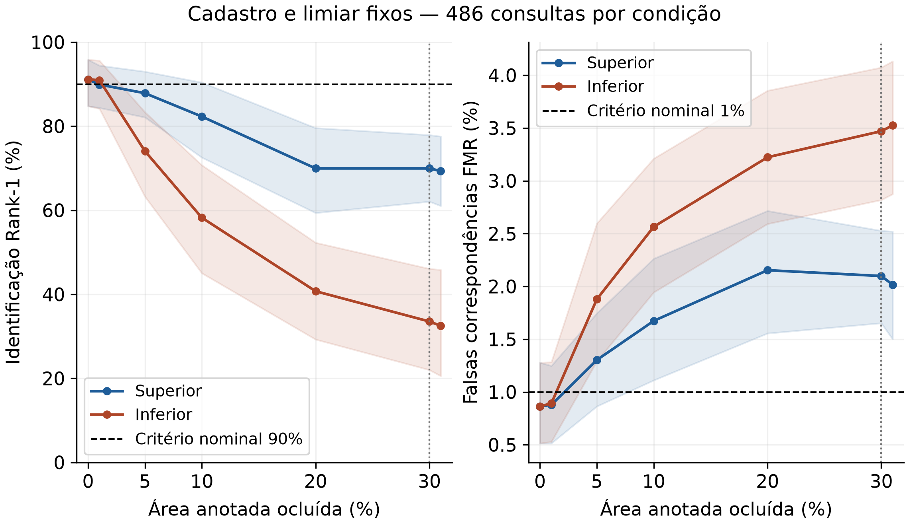

# Resultado para a defesa do PFC

O ensaio completo mede o efeito de retirar informação visível da imagem sobre uma cadeia de identificação ocular. Não estima um limite universal de anatomia nem o efeito causal de uma doença.

A tentativa de fusão aprendida não superou o controle na validação fora das dobras e manteve os pesos históricos. A curva principal usa esse controle e seu limiar histórico fixo; o ajuste não é anunciado como melhoria.

| Oclusão | Suporte nominal restante | Rank-1 superior | Rank-1 inferior | TAR superior | TAR inferior | FMR superior | FMR inferior |
|---:|---:|---:|---:|---:|---:|---:|---:|
| 0% | 100% | 91.15% | 91.15% | 92.39% | 92.39% | 0.864% | 0.864% |
| 1% | 99% | 89.92% | 90.95% | 92.18% | 91.15% | 0.878% | 0.892% |
| 5% | 95% | 87.86% | 74.07% | 88.89% | 77.78% | 1.303% | 1.879% |
| 10% | 90% | 82.30% | 58.23% | 84.57% | 60.91% | 1.674% | 2.565% |
| 20% | 80% | 69.96% | 40.74% | 72.63% | 40.33% | 2.154% | 3.224% |
| 30% | 70% | 69.96% | 33.54% | 69.96% | 32.30% | 2.099% | 3.471% |
| 31% | 69% | 69.34% | 32.51% | 70.99% | 29.42% | 2.016% | 3.525% |

Na orientação superior, passar de 30% para 31% de oclusão mudou o Rank-1 em -0.62 pontos percentuais. O intervalo de 95% da perda foi [-1.81; 3.12] pontos; 20 consultas perderam acerto e 17 ganharam acerto.
Na orientação inferior, passar de 30% para 31% de oclusão mudou o Rank-1 em -1.03 pontos percentuais. O intervalo de 95% da perda foi [-2.88; 5.21] pontos; 34 consultas perderam acerto e 29 ganharam acerto.

Use na defesa: “No sistema e no protocolo avaliados, a extensão e a localização da oclusão alteraram o reconhecimento. A passagem de 70% para 69% do suporte anotado foi medida diretamente, mas não constitui teste de um limiar anatômico universal de 70%.”

A ISO/IEC 29794-6:2015 trata qualidade da imagem e área utilizável em relação ao anel estimado. Nossa máscara contém somente a região originalmente anotada; 70% e 69% nesta curva usam outro denominador. A base não fornece a pupila como classe anatômica independente. Não foi validada uma medição normativa do anel completo.

O estudo mantém 486 consultas e 7.290 pares impostores em cada condição, com 16 candidatos do mesmo lado e cadastro original. As seis referências vazias permanecem nas métricas e têm área indefinida; a área real é conferida em 480 consultas. A auditoria inclui uma sensibilidade secundária no subconjunto fixo dessas 480 referências, sem substituir a análise principal. Os intervalos são descritivos, por pessoa, com galeria fixa; o teste já foi consultado durante o desenvolvimento. Não se recalibra o limiar em cada oclusão.

Os intervalos pareados desta análise usam 5.000 reamostragens e semente 20261108. O campo auxiliar pareado do relatório bruto foi produzido pela função histórica com semente 20261001; não é utilizado nas conclusões desta análise. As contagens e taxas brutas não mudam.

Fontes normativas: [ISO](https://www.iso.org/standard/54066.html); [prévia pública da norma, seção 6.2.1.4](https://cdn.standards.iteh.ai/samples/54066/5bd98d11a8824ab29d5935edbfe997a9/ISO-IEC-29794-6-2015.pdf).

Fonte da fotografia e anotação: UBIPr Single Eyes Segmented, Padole e Proença (2012), CC BY-NC-SA 4.0. Oclusões e composição do autor.
