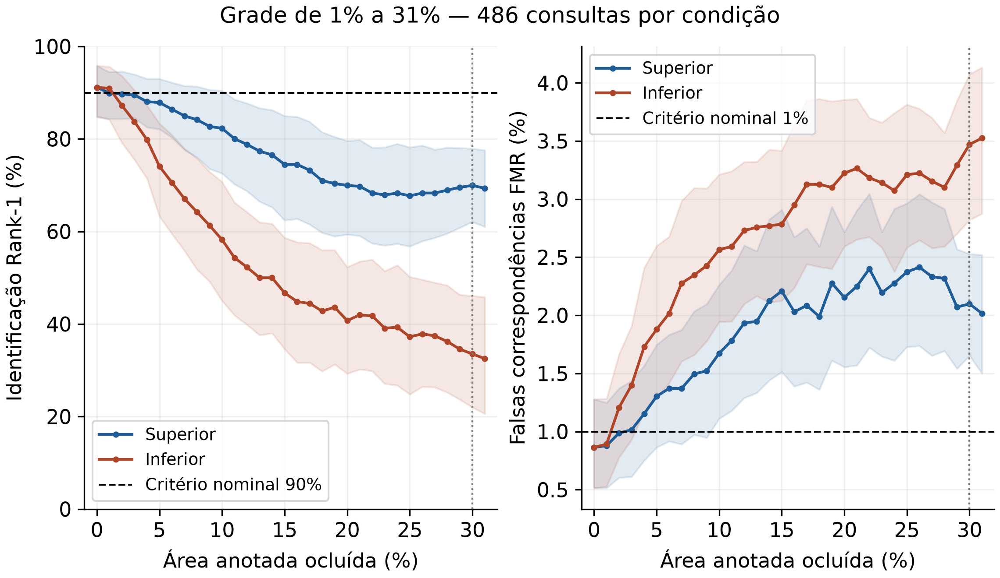
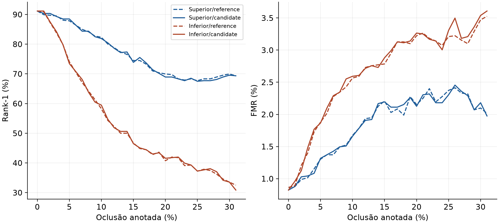

# Resultado da grade completa de 1% a 31%

Foram auditadas 63 condições: controle e todos os níveis inteiros de perda nas duas orientações. Em cada condição foram mantidas 486 consultas, inclusive falhas, e 7.290 pares impostores.

| Perda | Suporte | Rank-1 superior | Rank-1 inferior | TAR superior | TAR inferior | FMR superior | FMR inferior |
|---:|---:|---:|---:|---:|---:|---:|---:|
| 0% | 100% | 91,15% | 91,15% | 92,39% | 92,39% | 0,864% | 0,864% |
| 1% | 99% | 89,92% | 90,95% | 92,18% | 91,15% | 0,878% | 0,892% |
| 2% | 98% | 89,71% | 87,24% | 91,15% | 87,86% | 0,988% | 1,207% |
| 3% | 97% | 89,51% | 83,74% | 90,95% | 83,74% | 1,015% | 1,399% |
| 4% | 96% | 88,07% | 79,84% | 89,71% | 79,84% | 1,152% | 1,728% |
| 5% | 95% | 87,86% | 74,07% | 88,89% | 77,78% | 1,303% | 1,879% |
| 6% | 94% | 86,42% | 70,58% | 87,65% | 73,87% | 1,372% | 2,016% |
| 7% | 93% | 84,98% | 67,08% | 86,42% | 69,75% | 1,372% | 2,277% |
| 8% | 92% | 84,16% | 64,20% | 87,04% | 67,08% | 1,495% | 2,346% |
| 9% | 91% | 82,72% | 61,32% | 85,80% | 61,93% | 1,523% | 2,428% |
| 10% | 90% | 82,30% | 58,23% | 84,57% | 60,91% | 1,674% | 2,565% |
| 11% | 89% | 80,04% | 54,32% | 82,10% | 55,76% | 1,783% | 2,593% |
| 12% | 88% | 78,81% | 52,26% | 80,66% | 52,06% | 1,934% | 2,730% |
| 13% | 87% | 77,37% | 50,00% | 77,98% | 51,23% | 1,948% | 2,757% |
| 14% | 86% | 76,54% | 50,00% | 78,40% | 51,03% | 2,126% | 2,771% |
| 15% | 85% | 74,49% | 46,71% | 76,34% | 48,97% | 2,209% | 2,785% |
| 16% | 84% | 74,49% | 44,86% | 74,49% | 45,68% | 2,030% | 2,949% |
| 17% | 83% | 73,25% | 44,44% | 75,72% | 45,27% | 2,085% | 3,128% |
| 18% | 82% | 70,99% | 42,80% | 74,49% | 42,80% | 1,989% | 3,128% |
| 19% | 81% | 70,37% | 43,62% | 73,46% | 42,18% | 2,277% | 3,100% |
| 20% | 80% | 69,96% | 40,74% | 72,63% | 40,33% | 2,154% | 3,224% |
| 21% | 79% | 69,75% | 41,98% | 72,02% | 39,30% | 2,250% | 3,265% |
| 22% | 78% | 68,31% | 41,77% | 69,34% | 38,68% | 2,401% | 3,182% |
| 23% | 77% | 67,90% | 39,09% | 69,75% | 38,48% | 2,195% | 3,141% |
| 24% | 76% | 68,31% | 39,30% | 69,96% | 38,27% | 2,277% | 3,073% |
| 25% | 75% | 67,70% | 37,24% | 70,58% | 36,21% | 2,373% | 3,210% |
| 26% | 74% | 68,31% | 37,86% | 68,72% | 34,57% | 2,414% | 3,224% |
| 27% | 73% | 68,31% | 37,45% | 69,96% | 35,60% | 2,332% | 3,155% |
| 28% | 72% | 68,93% | 36,21% | 70,37% | 33,54% | 2,318% | 3,100% |
| 29% | 71% | 69,55% | 34,57% | 69,96% | 32,92% | 2,071% | 3,292% |
| 30% | 70% | 69,96% | 33,54% | 69,96% | 32,30% | 2,099% | 3,471% |
| 31% | 69% | 69,34% | 32,51% | 70,99% | 29,42% | 2,016% | 3,525% |

## Fronteira observada, condicionada à grade

- reference/oclusao_superior/marginal: suporte mínimo no prefixo = 100%; perdas aprovadas = [0].
- reference/oclusao_superior/joint90: suporte mínimo no prefixo = None%; perdas aprovadas = [].
- reference/oclusao_inferior/marginal: suporte mínimo no prefixo = 99%; perdas aprovadas = [0, 1].
- reference/oclusao_inferior/joint90: suporte mínimo no prefixo = None%; perdas aprovadas = [].
- candidate/oclusao_superior/marginal: suporte mínimo no prefixo = 99%; perdas aprovadas = [0, 1].
- candidate/oclusao_superior/joint90: suporte mínimo no prefixo = 100%; perdas aprovadas = [0].
- candidate/oclusao_inferior/marginal: suporte mínimo no prefixo = 99%; perdas aprovadas = [0, 1].
- candidate/oclusao_inferior/joint90: suporte mínimo no prefixo = 100%; perdas aprovadas = [0].

Regra completa de comparação do candidato aprovada: **False**. Melhoras locais e o critério absoluto de 90/90/1 são distintos.

## Alcance

Suporte nominal restante é relativo à anotação original, sem medir o anel completo da ISO ou a extensão de doença. A grade inteira reduz a lacuna entre pontos testados, mas não estabelece mínimo universal. O processamento foi recalculado após cada perda; o efeito reúne textura retirada e instabilidade de segmentação/geometria.

O subconjunto secundário mantém as mesmas 480 referências definidas, sem selecionar acertos. Os intervalos são descritivos, por pessoa, com galeria fixa e teste previamente exposto ao desenvolvimento. Não certificam simultaneamente toda a curva nem substituem confirmação independente.
